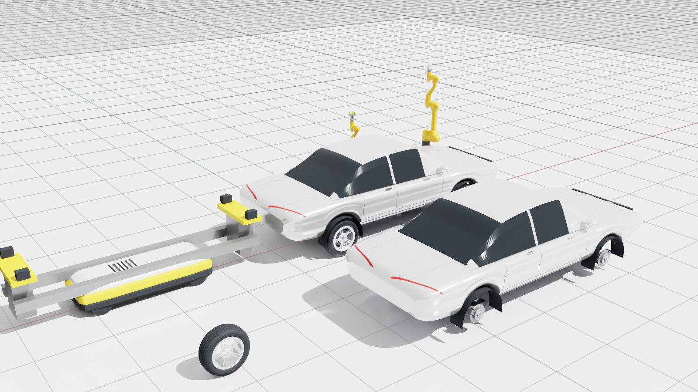

# CN7 휠 조립 셀 — 모델 에셋과 규격·물리 정리

휠 조립 셀(`map/scene/wheel_cell.usda`)에 쓰이는 AMR, 차체, 바퀴, 카메라를 **각각 따로 열 수 있는 USD 파일**로 정리했습니다.
각 파일은 메시와 재질을 모두 안에 담고 있어 다른 장면에 참조(reference)로 바로 끌어다 쓸 수 있습니다. 공정 장면은 이 파일들을 쓰지 않으므로, 통합 작업과 서로 영향을 주지 않습니다.

이 문서는 저장소 곳곳에 흩어져 있던 **AMR·차체·바퀴(타이어+림)의 규격과 물리 설정**도 한곳에 모은 것입니다(2026-11-28). 값마다 어느 코드가 실제로 쓰는지 적었고, 파일끼리 값이 다른 곳은 [값 대조 결과](#값-대조-결과)에 정리했습니다. 확정한 것은 **차체 질량 1,196.6 kg(바퀴 17.1 kg)**과 **허브 플랜지 반지름 69 mm** 두 가지이고, 나머지는 그대로 둡니다.



| AMR과 바퀴 |
|---|
|  |

장착·체결 로봇은 둘 다 고정식 Kawasaki RS080N이며, 로봇 에셋은 [`map_fasten/assets/RS080N.usdc`](../map_fasten/assets/RS080N.usdc)(URDF `rs080n.urdf`, Kawasaki `khi_robot` 메시)를 씁니다.

## 값의 기준 파일

같은 값을 여러 곳에 다시 적지 말고 아래 파일에서 읽어 쓰는 것이 원칙입니다. 이 문서의 표도 이 파일들에서 옮겨 왔으며, 값이 바뀌면 이 파일들이 기준입니다.

| 파일 | 담당 | 쓰는 곳 |
|---|---|---|
| [`wheel_cell/physical_data.py`](../wheel_cell/physical_data.py) | 질량(차체·바퀴·AMR·리프트), AMR 속도·크기, 컨베이어, 패드·가이드 마찰 | 라이브 셀, 에셋 생성, AMR URDF |
| [`wheel_cell/fitment.py`](../wheel_cell/fitment.py) | 차체 치수(전장·전폭·축거·윤거), 휠·허브 맞춤 치수(PCD, 보어, 파일럿, 스터드, 오프셋) | 라이브 셀, 장면 생성 |
| [`wheel_cell/process.py`](../wheel_cell/process.py) | 공정 위치(허브 높이, 도크 위치, 로봇 위치), 타이어 규격 `CN7_R16` | 라이브 셀, 장면, 장착 시뮬 |
| [`wheel_cell/cell_config.py`](../wheel_cell/cell_config.py) · [`calibration.json`](../wheel_cell/calibration.json) | 실측 전 추정값(현가, 베어링, 타이어 강성, 센서 잡음)과 실측 방법 | 라이브 셀 |
| [`wheel_mount_sim/params.py`](../wheel_mount_sim/params.py) · [`PARAMS_table.md`](../wheel_mount_sim/PARAMS_table.md) | 장착 시뮬 값(값마다 근거 종류: 카탈로그·순정·문헌·계산·모델·추정) | 장착 단독 시뮬, 셀 통합 시 라이브 셀 값 일부를 덮어씀(`wheel_mount_sim/cell_mount.py`) |

## 1. AMR — KUKA KMP 1500 omniMove

### 사양 (KUKA 사양서)

| 항목 | 값 | 근거 |
|---|---|---|
| 외형 | 2,000 × 800 × 470 mm (스캐너 포함) | 사양서 "Dimensions" |
| 질량 | 차대 711 kg + 리프트 144 kg = 855 kg | 사양서 "Weight", "Lifting system – Weight +144 kg" |
| 정격 적재 | 1,500 kg | 사양서 |
| 속도 | 직진 1.0 m/s, 대각·횡 0.56 m/s | 사양서 "Velocity" |
| 리프트 | 행정 최대 200 mm, 최대 50 mm/s | 사양서 "Lift table height max. 200 mm", "Lifting speed max. 50 mm/s" |
| 바퀴 | 메카넘 Ø310 mm × 4 (위치 x ±0.72, y ±0.31 m는 추정) | 사양서 "Wheel diameter 310 mm" |
| 안전 스캐너 | SICK S300 × 2, 대각선 두 모서리 (기종은 같은 계열 자료로 채택) | [`wheel_cell/README.md`](../wheel_cell/README.md#kmp-1500-urdf-ros-2--isaac-urdf-importer용) |

### 물리 설정

| 항목 | 라이브 셀 (`cell.py`, `carrier.py`) | 에셋 `amr/KUKA_KMP1500_AMR.usd` |
|---|---|---|
| 몸체 | `DockedAMR` 711 kg (무게중심 z 0.23 m, 상자 관성) + `DockLift` 144 kg (무게중심 z 0.58 m) | 다관절 하나: `Chassis` 711 kg + `Hanger` 144 kg |
| 리프트 관절 | 수직 직선 관절, 범위 −0.06 ~ +0.14 m (200 mm), 강성 1.6 MN/m, 최대 힘 (1,500+144) kg × g | `LiftJoint` 범위 −0.12 ~ 0 m (장면 애니메이션의 120 mm만 담음) |
| 주행 | 바퀴는 마찰 0인 구 4개로 받치고, 이동은 등가 추진력(견인계수 0.4 × 총질량 × g, 가속 0.25 m/s²)으로 계산. 메카넘 롤러 미끄러짐·모터 전달계는 생략 | 주행 없음 (바깥에서 차대를 움직여 씀) |
| 도크 클램프 | A·B·C 정차점마다 4개(12개), y 방향 직선 관절, 행정 0.284 m(열림 0.72 → 닫힘 0.436 m), 속도 0.12 m/s, 강성 2 MN/m, 최대 20 kN(닫히면 잠기는 클램프로 본 추정값) | 없음 |
| 충돌 | 차대 2.0 × 0.8 × 0.33 m 상자 | 차대 2.0 × 0.8 × 0.47 m 상자, 행거는 새들 레일과 받침 패드 |

견인계수 0.4, 가속 0.25 m/s²는 추정값입니다(`calibration.json` `amr_traction_coefficient`). ROS 2용 URDF는 `wheel_cell/assets/kmp1500.urdf`이고 `wheel_cell/kmp1500_urdf.py`가 같은 `physical_data.py` 값으로 만듭니다(리프트 0–200 mm).

## 2. 차체 — 현대 아반떼 CN7 페이스리프트 G1.6 IVT (16인치)

### 사양

| 항목 | 값 | 근거 |
|---|---|---|
| 전장 · 전폭 | 4,710 · 1,825 mm | [현대차 카탈로그](https://www.hyundai.com/contents/repn-car/catalog/the-new-avante-catalog.pdf) |
| 축거 | 2,720 mm (A→B, B→C 인덱스 이동 거리와 같음) | 카탈로그 |
| 윤거 | 앞 1,585 / 뒤 1,596 mm | 카탈로그 |
| 공차중량 | 1,265 kg | 카탈로그 |
| 차체 질량 (바퀴 제외) | **1,196.6 kg** = 1,265 − 4 × 17.1 | `physical_data.BODY_MASS` |
| 휠하우스 | 아치 반지름 0.365 m, 아치 범위 −9.9° ~ 189.9°, 차축 방향 −0.119 ~ +0.113 m | 차체 메시에서 잰 모델값 |

### 물리 설정

| 항목 | 라이브 셀 (`cell.py`) | 에셋 `vehicle/Hyundai_Avante_CN7_Body.usd` |
|---|---|---|
| 강체 | 동적 강체 하나, 1,196.6 kg | 강체 하나, 1,201.5 kg (림 무게 변경 전 값, [한계](#한계와-추정값) 참고) |
| 무게중심·관성 | 지정 안 함 → PhysX가 충돌 형상에서 계산 (실차 값으로 교정 안 됨) | 원점 근처로 계산 (교정 안 됨) |
| 충돌 형상 | `Undertray` 3.70 × 1.16 × 0.23 m (z 1.10), `Body` 4.56 × 1.57 × 0.36 m (z 1.55), 사이드실·범퍼 모서리 블록(0.1 m 간격, 높이 0.10 m, 휠 아치 구간 제외) | 외판의 볼록 껍질 + 언더트레이 상자 |
| 접촉 | contact offset 2 mm, rest offset 0 | 기본값 |
| 재질 | 지정 없음 → PhysX 기본 재질 | 지정 없음 |
| 솔버 | 240 Hz, 위치 반복 64, 속도 반복 8 | — |

### 코너 4곳 (허브·너클·현가)

장착 시뮬을 셀에 통합하면(`CELL_MOUNT_SIM` 기본 켜짐) 오른쪽 열의 값으로 덮어씁니다. 끄려면 `CELL_MOUNT_SIM=0`.

| 항목 | 셀 원래 값 (`corner.py`, `cell_config.py`) | 장착 시뮬 통합 후 (`wheel_mount_sim/params.py`) | 근거 |
|---|---|---|---|
| 허브 질량 | 6.5 kg | 같음 | 추정 |
| 너클 질량 | 11 kg | 같음 | 추정 |
| 현가 상하 강성 | 22 N/mm | 23.07 N/mm | 셀: 준중형 일반값 추정 / 통합: 승차 진동수 1.3 Hz에서 계산 |
| 현가 예압 | 6 mm (= 132 N) | 300 N | 둘 다 추정 (리바운드 스토퍼에 걸린 상태) |
| 현가 감쇠 | 1,800 N·s/m | 같음 | 추정 |
| 차축 방향 강성 | 900 N/mm, ±4 mm | 같음 | 추정 |
| 베어링 끌림 | 1.2 N·m | 0.75 N·m | 셀: 추정 / 통합: 허브 유닛 특허의 설계 한계 |
| 베어링 반경 유격 | 0.03 mm | 0 | 통합: 3세대 허브 유닛은 예압이 걸려 유격 없음 |

## 3. 바퀴 — 205/55 R16 타이어 + 16 × 6.5J ET46 휠

### 규격

| 항목 | 값 | 근거 종류 | 근거 |
|---|---|---|---|
| 타이어 | 205/55 R16, 폭 205 mm, 편평비 55 | 카탈로그 | Continental ProContact RX `15570360000` |
| 외경 | 631.9 mm (= 16 × 25.4 + 2 × 0.205 × 0.55 × 1000) | 계산 | `process.CN7_R16` |
| 림 | 16 × 6.5J, 오프셋 ET46, 순정 품번 52910-AB200/AA230 | 순정 | 여러 판매처에서 확인 |
| 센터 보어 | Ø67.1 mm | 순정 | |
| PCD | 5 × 114.3 mm, 볼트 원 반지름 57.15 mm | 순정 | |
| 스터드·너트 | M12 × 1.5, 공칭 체결 토크 107–127 N·m | 순정 | [현대차 매뉴얼](https://ownersmanual.hyundai.com/full_webhelp/CN7/2025/en_GN/idf379ca53e75.html) |
| 볼트 구멍 | Ø13.4 mm, 너트 시트 입구 Ø22.4 mm | 모델 (CN7 도면 없음) | `fitment.py` |
| 장착면(웹) 두께 | 14 mm (보어 길이 최악 경우) | 모델 | `fitment.py` |
| 허브 쪽 보어 모따기 | 1.5 mm × 45° | 추정 | `wheel_mount_sim/params.py` |
| 질량 | **17.1 kg** = 타이어 8.0 + 림 9.1 | 카탈로그 + 문헌 | 림 9.1 kg은 wheel-size.com 한 곳의 값(검증 안 됨, 하중 쪽으로 보수적) |

### 허브 맞춤 치수 (차량 쪽)

| 항목 | 값 | 근거 종류 |
|---|---|---|
| 허브 파일럿 | Ø66.94 × 12 mm (반경 틈 0.08 mm), 시드마다 지름 −0.03 ~ 0 mm 공차 | 모델 (실측 전 가정) |
| 스터드 돌출 | 30 mm, 위치 공차 반지름 0.05 mm, PCD 공차 0.05 mm | 모델 |
| 허브 플랜지 반지름 | **69 mm (Ø138) 확정** (2026-11-28). 셀 `fitment.FLANGE_RADIUS`는 아직 79 mm라 맵팀 반영 대기 ([값 대조 결과](#값-대조-결과) 3번) | 문헌 (CN7 계열 애프터마켓 허브 외경 약 138 mm, 자료 한 곳) |
| 브레이크 디스크 | 앞 Ø280 × 25 mm, 뒤 Ø262 × 10 mm | 모델 |
| 허브 높이 | 차를 행거에 올린 상태 z 0.94 m (`process.HUB_Z`). 바퀴를 끼우고 바닥에 놓으면 0.316 m | 모델 |

### 타이어 물리 (링 타이어: 림과 트레드 링이 별도 강체, 스프링 연결)

| 항목 | 셀 원래 값 (`cell_config.py`) | 장착 시뮬 통합 후 (`params.py`) | 근거 |
|---|---|---|---|
| 반경 강성 | 210 N/mm | 180 N/mm | 셀: 2.3 bar 문헌 추정 / 통합: 승용 타이어 실측 평균(Eksploatacja i Niezawodność 2014) |
| 횡 강성 | 140 N/mm | 65 N/mm | 같은 순서 |
| 비틀림 강성 | 55 N·m/° | 139 N·m/° (= 원주 강성 80 N/mm × R²) | 같은 순서 |
| 감쇠비 | 0.08 | 0.08 | 추정 (0.05–0.10 범위 시험) |
| 관성 | 타이어·림의 고리 단면으로 추정 (`physical_data.wheel_inertia`) | 같음 | 추정 |

## 4. 차체를 AMR에 붙잡는 방식

라이브 셀(`cell.py`, `carrier.py`) 기준입니다. 차체는 AMR 리프트 위에 **얹혀** 있고 관절로 묶여 있지 않습니다.

| 부품 | 위치 (리프트 기준) | 설정 |
|---|---|---|
| 받침 패드 4개 | x ±1.65, y ±0.40, z 0.927 m, 0.16 × 0.10 × 0.116 m | 고무 마찰 정지 0.82 / 운동 0.67 |
| 옆면 위치결정 블록 2개 | y ±0.615 (사이드실 옆), 0.20 × 0.06 × 0.06 m | 팝업식 공압, 60 mm 행정, 최대 1,500 N. 실을 때 올리고 차 밑으로 들어갈 때 내림 |
| 앞뒤 위치결정 블록 2개 | x ±1.885 (차체 끝), 0.06 × 0.20 × 0.06 m | 같음 |
| 도크 클램프 12개 | A·B·C 정차점 바닥 설비, AMR 차대를 양옆(y)에서 잡음. 앞뒤 두 쌍(x ±0.40 m)이 회전도 막음 | 최대 20 kN, 2 MN/m (추정, 2026-11-28 전에는 400 N, 12 kN/m) |

**장착 하중 확인 (2026-11-28)**: 차체를 동적으로 풀고(AMR·리프트는 고정) 시드 42로 앞바퀴 좌우를 장착했습니다. 미는 힘은 설정 145 N, 기록된 최대 156 N이었고 오른쪽 걸림 재시도도 1번 있었습니다. 차체 변위는 최대 x 0.0027 · y 0.0034 · z 0.0001 mm, 요 0.0001°였습니다. 손계산으로도 받침 마찰만으로 옆으로 약 3,170 N(마찰계수 0.27로 낮게 잡음)을 버텨 미는 힘의 약 20배입니다. 결과는 `wheel_mount_sim/output/cell/cardyn42/`(커밋 안 함)에 있습니다.

**AMR 고정 확인 (2026-11-28)**: 이번에는 AMR을 고정하지 않고 차·AMR만 물리로 둔 셀에서, A 정차 중 앞 왼쪽 허브에 −y로 145 N을 0.3초 가했습니다(`amr_part/tools/isaac_live_ros.py`). 차는 행거 위에서 움직이지 않았습니다(0 mm). 그런데 클램프가 없으면 AMR이 차째 바닥에서 밀려, 허브가 y −8.4 mm까지 갔다가 −4.5 mm에 남았습니다(AMR y −3.5 mm, 방향 최대 −0.22°). AMR 주행 서보는 속도만 맞추고 원래 자리로 돌아오지 않기 때문입니다. 정차점 클램프를 닫고 잠그면 허브 이동은 0.1 mm 이하였습니다. 이전 클램프 값(12 kN/m, 400 N)은 스프링처럼 동작해 145 N에 약 3 mm 밀리므로 잠금 값으로 바꿨습니다. B·C 클램프를 넣은 라이브 셀은 `check_physics.sh --layout-probe`로 A·B·C 정차(오차 0.3 mm 이내)와 출차(58.3 s)를 통과했습니다.

## 5. 마찰계수 모음

| 접촉 | 정지 / 운동 | 쓰는 곳 | 근거 |
|---|---|---|---|
| 행거 받침 패드 (고무) | 0.82 / 0.67 | 라이브 셀 | 추정 |
| 차체 충돌체 | PhysX 기본 재질 | 라이브 셀 | 지정 없음 |
| 그리퍼 패드 ↔ 트레드 (셀) | 0.35 / 0.28 | 라이브 셀 | SCHUNK HKI 0.3–0.4, 시편 시험 필요 |
| 우레탄 슈 ↔ 트레드 (장착) | 0.6 / 0.5 | 장착 시뮬 | 추정, 0.35–0.9 범위 시험 |
| 트레드 ↔ 강 | 0.7 / 0.55 | 장착 시뮬 | 문헌 (건조 강 위 고무 0.6–0.8) |
| 휠 장착면(알루미늄) ↔ 허브(강) | 0.61 / 0.47 | 장착 시뮬, 셀 통합 후 | 문헌 (도장·아연 면은 0.3까지 시험) |
| 허브 면·스터드 (셀 강) | 0.27 / 0.22 | 셀 원래 (`CELL_MOUNT_SIM=0`) | 추정 |
| 컨베이어 가이드 (UHMW-PE) | 0.28 / 0.22 | 라이브 셀 | TIVAR 1000 EC 데이터시트 |
| AMR 바퀴 ↔ 바닥 | 견인계수 0.4 (등가 힘) | 라이브 셀 | 추정 |

## 값 대조 결과

2026-11-28에 위 기준 파일, `wheel_cell/README.md`, `wheel_cell/HANDOVER.md`, `wheel_mount_sim/` 문서, 에셋 USD를 서로 대조했습니다.

**일치하는 값**: 전장·전폭·축거·윤거, 공차중량, 차체 질량 1,196.6 kg(에셋 제외), 바퀴 17.1 kg(에셋 제외), 타이어 규격·외경, 림 6.5J ET46, 보어 Ø67.1, PCD 5 × 114.3, M12 × 1.5, 볼트 구멍 Ø13.4, 파일럿 Ø66.94 × 12, 웹 14 mm, 스터드 돌출 30 mm, 허브 높이 0.94 m, 허브·너클 질량, AMR 질량·크기·속도.

**서로 다른 값**

| # | 항목 | 값 A | 값 B | 판단 |
|---|---|---|---|---|
| 1 | 차체·바퀴 질량 | 에셋 USD: 차체 1,201.5 kg, 바퀴 15.9 kg (림 7.9 kg) | `physical_data.py`: 1,196.6 kg, 17.1 kg (림 9.1 kg) | **확정: 차체 1,196.6 kg, 바퀴 17.1 kg.** 에셋 USD는 형상을 그대로 두고 질량 값과 `cn7:spec`만 고칠 예정 (전체 재생성은 장면 형상까지 바뀌므로 하지 않음) |
| 2 | AMR 리프트 행정 | 에셋 `LiftJoint` 120 mm, `cn7:spec`의 `liftStrokeM` 0.12 (옛 문서는 이를 규격으로 적음) | 사양서·라이브 셀·URDF 200 mm | **규격은 200 mm.** 에셋은 장면 애니메이션의 이동량(120 mm)만 담으며 그대로 둠 |
| 3 | 허브 플랜지 반지름 | 셀 `fitment.FLANGE_RADIUS` 79 mm (Ø158, 라이브 셀 허브 면 충돌체) | 장착 단독 시뮬 `params.FLANGE_R` 69 mm (Ø138, 애프터마켓 허브 외경 자료) | **확정: 69 mm.** 79 mm는 근거 표시 없음. 맵팀에 `fitment.py` 한 줄 변경을 요청 (라이브 셀 허브 면 충돌체에 바로 반영, 장면 겉모양은 다음 `build.sh` 때 반영). 체결팀이 쓰는 PCD·오프셋·너트 시트 값은 그대로. 반영 후 장착 결과(놓은 뒤 틈·기울기) 재확인. 실측되면 다시 고침 |
| 4 | 타이어 강성 | 셀 210 / 140 N/mm, 55 N·m/° | 장착 시뮬 180 / 65 N/mm, 139 N·m/° | 그대로 둠 (의도된 차이). 장착 시뮬 쪽이 문헌 근거가 있어 셀 통합 시 덮어씀. 셀 원래 값은 `CELL_MOUNT_SIM=0`일 때만 쓰임 |
| 5 | 현가·베어링 | 셀 22 N/mm·예압 6 mm, 끌림 1.2 N·m·유격 0.03 mm | 장착 시뮬 23.07 N/mm·300 N, 0.75 N·m·유격 0 | 그대로 둠 (위와 같음) |
| 6 | 그리퍼 기종 주석 | `physical_data.py` 주석·값: SCHUNK PHL-W 40-100 (100 mm, 1,300 N) | 현재 장착 공구: PHL-W 63-080-S (80 mm, 4,630 N) | 셀 원래 그리퍼(`JAW_STROKE`, `JAW_FORCE`)용 옛 값. 셀 통합 시 장착 시뮬 그리퍼로 바뀌고 어디에서도 읽지 않음. 그대로 둠 |

## 폴더 구성

```
map/assets/
├── amr/
│   └── KUKA_KMP1500_AMR.usd          # AMR 차대 + 차체 행거(승강)
├── tools/
│   └── RealSense_D455.usd            # 손목 카메라
├── vehicle/
│   ├── Hyundai_Avante_CN7_Body.usd   # 차체 (허브·브레이크·현가 포함, 바퀴 장착 선택 가능)
│   └── CN7_Wheel_205-55R16.usd       # 타이어 + 휠(림) 한 벌
├── images/                           # 이 문서의 그림
├── build_assets.py / build_assets.sh # 장면에서 에셋을 다시 뽑아내는 스크립트
└── check_assets.py / check_assets.sh # 물리 동작 시험
```

이미 있던 것은 새로 만들지 않고 그대로 씁니다.

| 기존 파일 | 쓰임 |
|---|---|
| `wheel_cell/assets/tire_example.usda` | 타이어 고무만 있는 메시. 바퀴 에셋의 `Tire`가 이 메시입니다 |
| `wheel_cell/assets/d455_tool.usda` | D455 원본 메시. `tools/RealSense_D455.usd`가 이 메시입니다 |

## 에셋 한눈에 보기

| 구분 | 파일 | 모델명 | 에셋에 담긴 질량 |
|---|---|---|---|
| AMR | `amr/KUKA_KMP1500_AMR.usd` | KUKA KMP 1500 omniMove | 차대 711 kg + 승강부 144 kg |
| 차체 | `vehicle/Hyundai_Avante_CN7_Body.usd` | 현대 아반떼 CN7 페이스리프트 G1.6 IVT | 1,201.5 kg (옛 값, 1,196.6 kg으로 고칠 예정) |
| 바퀴 | `vehicle/CN7_Wheel_205-55R16.usd` | 205/55 R16 타이어 + 6.5J × 16 휠 | 15.9 kg (옛 값, 17.1 kg으로 고칠 예정) |
| 카메라 | `tools/RealSense_D455.usd` | Intel RealSense D455 (브래킷 포함), 124 × 29 × 26 mm | 0.116 kg |

규격은 위 1–3절을 보세요.

## 공통 약속

- 단위: 미터, 킬로그램, 각도는 도(°). 위쪽은 +Z.
- 각 파일의 최상위 노드가 기본 노드(defaultPrim)입니다. 참조할 때 경로를 따로 적지 않아도 됩니다.
- 최상위 노드의 `customData["cn7:spec"]`에 규격이 들어 있어서, 코드에서 `prim.GetCustomDataByKey("cn7:spec")`로 읽을 수 있습니다(에셋을 만든 때의 값).
- 재질은 파일마다 `<최상위>/Looks` 아래에 들어 있습니다.
- 충돌 형상은 보이지 않도록 `guide` 용도로 두었습니다(뷰포트의 표시 설정에서 켜면 보입니다).

## 에셋별 상세

### AMR — `amr/KUKA_KMP1500_AMR.usd`

| 항목 | 내용 |
|---|---|
| 원점 | 바닥면의 차대 중심, +X가 전진 방향 |
| 구성 | `Chassis`(차대: 외피, 구동륜 4개, 안전 스캐너 2개, 상태 표시등) · `Hanger`(차체 행거: 새들 레일 2, 지지대 2, 가로대 2, 차체 받침 패드 4) |
| 승강 | `LiftJoint` 범위 −0.12 ~ 0 m. 0이 들어 올린 상태(장면 기준 자세), −0.12가 내린 상태. 목표값은 `drive:linear:physics:targetPosition`(미터). 사양 행정은 200 mm |

### 차체 — `vehicle/Hyundai_Avante_CN7_Body.usd`

| 항목 | 내용 |
|---|---|
| 원점 | 앞뒤 차축의 가운데, 바닥 높이. +X가 차 앞, +Y가 차 왼쪽 |
| 구성 | `Visuals/SedanShell`(외판), `Undertray`, `TorsionBeam*`, `FrontSubframe`, 문 손잡이, 그릴, 휠하우스 4곳, 코너 4곳(`FL`/`FR`/`RL`/`RR`: 브레이크 디스크·캘리퍼, 허브 플랜지, 파일럿, 허브 볼트 5개, 너클, 쇼크업소버, 코일 스프링, 로어암) |
| 허브 | 허브 중심 높이 0.316 m(바퀴를 끼웠을 때 기준). PCD 5 × 114.3 mm, M12 × 1.5 |
| 선택 항목 | `wheels` 변형 세트: `none`(기본값, 조립 전) / `mounted`(바퀴 4개 장착). `mounted`에서는 바퀴 외형과 타이어 충돌 형상만 차체에 붙고 바퀴 질량은 더해지지 않습니다 |

Isaac Sim에서는 차체 노드를 선택한 뒤 속성 창의 **Variants → wheels**에서 바꿀 수 있습니다.

### 바퀴 — `vehicle/CN7_Wheel_205-55R16.usd`

| 항목 | 내용 |
|---|---|
| 원점 | 바퀴 중심. 회전축은 로컬 Z, +Z 쪽이 바깥면(스포크가 보이는 면) |
| 구성 | `Visuals/Tire`(타이어), `Barrel`, `CenterWeb`, `Spoke_0~4`, `ValveStem` |
| 물리 | 강체 하나. 관성은 타이어·림의 고리 단면으로 추정한 값(라이브 셀과 동일). 충돌은 타이어의 볼록 껍질 |

차량에 끼울 때는 왼쪽 바퀴를 X축으로 −90°, 오른쪽 바퀴를 +90° 돌리면 바깥면이 차 바깥을 향합니다.

## 사용법

Isaac Sim에서 파일을 그대로 열거나, 다른 장면에 끌어다 놓으면(참조) 됩니다. 코드로는:

```python
from pxr import Usd, UsdGeom, Gf
stage = Usd.Stage.Open("my_scene.usda")
car = stage.DefinePrim("/World/Car", "Xform")
car.GetReferences().AddReference("map/assets/vehicle/Hyundai_Avante_CN7_Body.usd")
car.GetVariantSet("wheels").SetVariantSelection("mounted")
```

## 다시 만들기와 검증

```bash
./map/wheel_cell/build.sh        # 장면을 먼저 최신으로 (형상·치수를 바꿨을 때만)
./map/assets/build_assets.sh     # 장면에서 에셋을 다시 뽑기
./map/assets/check_assets.sh     # CPU PhysX 동작 시험
```

`build_assets.py`는 장면 루트를 열어 주문 `CN7_001`(공정 시작 전 자세)과 공용 메시(`/AssetLibrary`)에서 형상을 복사하고, `physical_data.py`의 질량·관절·충돌을 붙입니다. 장면을 고친 뒤 다시 돌리면 에셋도 같이 바뀝니다. 파일을 손으로 고치면 다음 생성 때 덮어써지니, 바꿀 내용은 스크립트에 넣어 주세요.

2026-11-26에 확인한 결과(모두 통과, 로봇 항목은 RS080N 전환으로 삭제):

| 시험 | 결과 |
|---|---|
| 바퀴를 눕혀 떨어뜨림 → 중심 높이 | 0.102 m (기대 0.103 m) |
| 바퀴 장착 차체를 바닥에 놓음 → 원점 높이 | −3.5 mm (타이어 접지 눌림) |
| AMR을 바닥에 놓음 → 차대·행거 높이 | 0 mm / −0.7 mm (행거 유지) |

## 한계와 추정값

- 에셋 파일의 질량은 림 무게 변경(2026-11-27, `817f3a1`) 전에 만든 값입니다(차체 1,201.5 kg, 바퀴 15.9 kg). 확정값은 1,196.6 kg, 17.1 kg이며, 에셋은 형상을 그대로 두고 질량 값만 고칠 예정입니다. 라이브 셀은 에셋이 아니라 `physical_data.py` 값을 씁니다.
- 차체의 무게중심·관성은 실제 차량 값으로 교정되지 않았습니다. 에셋의 현가 장치는 움직이지 않는 외형입니다.
- 볼트 구멍, 파일럿, 웹 두께, 스터드 돌출은 CN7 도면이 없어 모델값이고, 허브 플랜지 69 mm도 공개 자료 한 곳의 값입니다. 실측이 필요합니다.
- 현가·베어링·타이어 강성과 마찰계수 대부분은 추정값입니다. 실측 방법은 `wheel_cell/calibration.json`에 있습니다.
- 정밀 삽입 시험용 허브·볼트 충돌(0.08 mm 여유)은 라이브 셀 코드(`wheel_cell/corner.py`)와 장착 시뮬에만 있고, 이 에셋의 충돌은 거친 근사입니다.
- AMR 메카넘 구동, 너트 체결 토크, 타이어 변형은 에셋에 들어 있지 않습니다.
