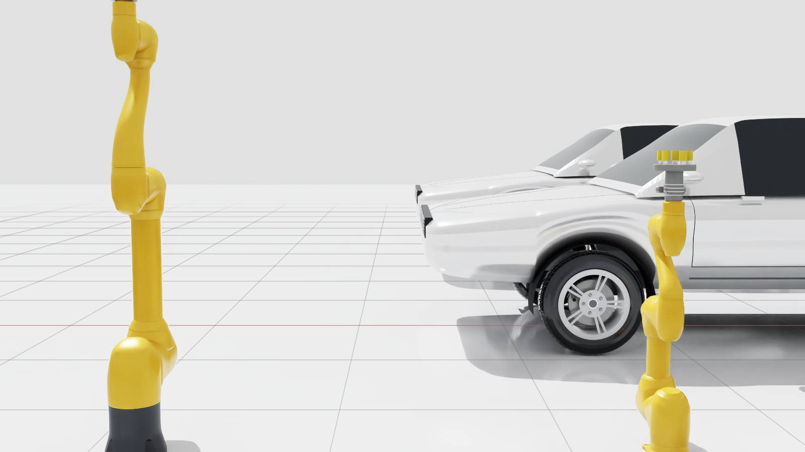
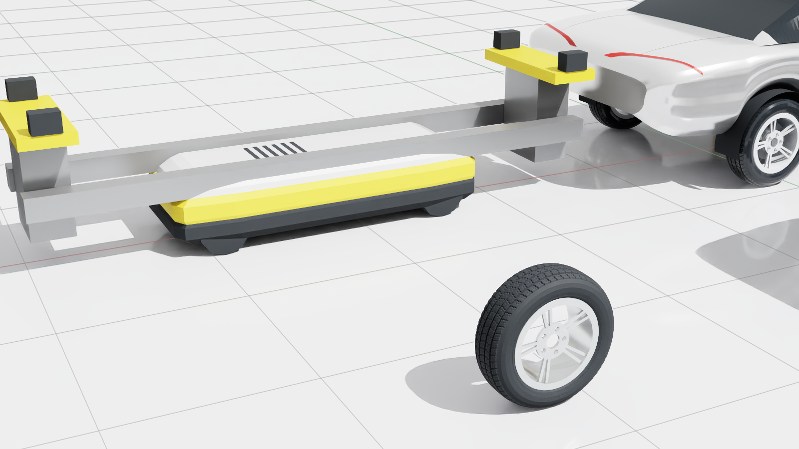

# CN7 휠 조립 셀 — 모델 에셋

휠 조립 셀(`map/scene/wheel_cell.usda`)에 쓰이는 AMR, 장착 로봇, 체결 로봇, 차체, 바퀴를 **각각 따로 열 수 있는 USD 파일**로 정리했습니다.
각 파일은 메시와 재질을 모두 안에 담고 있어 다른 장면에 참조(reference)로 바로 끌어다 쓸 수 있습니다. 공정 장면은 이 파일들을 쓰지 않으므로, 통합 작업과 서로 영향을 주지 않습니다.


| 로봇 두 종(왼쪽: 장착 로봇 H2515, 오른쪽: 체결 로봇 M1509) | AMR과 바퀴 |
|---|---|
|  |  |

## 폴더 구성

```
map/assets/
├── amr/
│   └── KUKA_KMP1500_AMR.usd          # AMR 차대 + 차체 행거(승강)
├── robots/
│   ├── Doosan_H2515.usd              # 장착 로봇 팔 본체 (공구 없음)
│   ├── Doosan_M1509.usd              # 체결 로봇 팔 본체 (공구 없음)
│   ├── MountRobot_H2515.usd          # 장착 로봇 = H2515 + 휠 가이드 그리퍼 + D455
│   └── FastenRobot_M1509.usd         # 체결 로봇 = M1509 + 5축 너트러너 + D455
├── tools/
│   └── RealSense_D455.usd            # 손목 카메라 (두 로봇이 함께 참조)
├── vehicle/
│   ├── Hyundai_Avante_CN7_Body.usd   # 차체 (허브·브레이크·현가 포함, 바퀴 장착 선택 가능)
│   └── CN7_Wheel_205-55R16.usd       # 타이어 + 휠(림) 한 벌
├── images/                           # 이 문서의 그림
├── build_assets.py / build_assets.sh # 장면에서 에셋을 다시 뽑아내는 스크립트
└── check_assets.py / check_assets.sh # 물리 동작 시험
```

이미 있던 것은 새로 만들지 않고 그대로 씁니다.

| 기존 파일 | 쓰임 |
|---|---|
| `wheel_cell/assets/h2515.urdf`, `m1509.urdf` | 로봇 관절 위치·한계·질량의 원본 (두산 공식 URDF) |
| `wheel_cell/assets/doosan_links.usdc` | 두산 공식 링크 메시 (장면 공용 메시를 거쳐 로봇 에셋에 들어감) |
| `wheel_cell/assets/tire_example.usda` | 타이어 고무만 있는 메시. 바퀴 에셋의 `Tire`가 이 메시입니다 |
| `wheel_cell/assets/d455_tool.usda` | D455 원본 메시. `tools/RealSense_D455.usd`가 이 메시입니다 |

## 모델 한눈에 보기

| 구분 | 파일 | 모델명 | 주요 규격 | 질량 |
|---|---|---|---|---|
| AMR | `amr/KUKA_KMP1500_AMR.usd` | KUKA KMP 1500 omniMove | 2,000 × 800 × 470 mm, 적재 1,500 kg, 직진 1.0 m/s · 횡주행 0.56 m/s, 승강 0.05 m/s · 행정 120 mm | 차대 711 kg + 승강부 144 kg |
| 장착 로봇 | `robots/MountRobot_H2515.usd` | Doosan H2515 + 휠 가이드 그리퍼 + D455 | 6축, 가반하중 25 kg, 작업 반경 1,500 mm | 팔 75.6 kg |
| 체결 로봇 | `robots/FastenRobot_M1509.usd` | Doosan M1509 + 5축 너트러너 + D455 | 6축, 가반하중 15 kg, 작업 반경 900 mm | 팔 33.2 kg |
| 차체 | `vehicle/Hyundai_Avante_CN7_Body.usd` | 현대 아반떼 CN7 페이스리프트 G1.6 IVT | 전장 4,710 · 전폭 1,825 mm, 축거 2,720 mm, 윤거 앞 1,585 / 뒤 1,596 mm | 1,201.5 kg (공차 1,265 kg − 바퀴 4개) |
| 바퀴 | `vehicle/CN7_Wheel_205-55R16.usd` | 205/55 R16 타이어 + 6.5J × 16 휠 | 외경 631.9 mm, 폭 205 mm, PCD 5 × 114.3 mm, 센터 보어 Ø67.1 mm | 15.9 kg (타이어 8.0 + 림 7.9) |
| 카메라 | `tools/RealSense_D455.usd` | Intel RealSense D455 (브래킷 포함) | 124 × 29 × 26 mm | 0.116 kg |

수치의 근거(카탈로그·데이터시트 주소)는 [`wheel_cell/README.md`의 "적용한 데이터"](../wheel_cell/README.md#적용한-데이터)와 같습니다. 같은 값을 `wheel_cell/physical_data.py`, `fitment.py`, `process.py`에서 그대로 읽어 씁니다.

## 공통 약속

- 단위: 미터, 킬로그램, 각도는 도(°). 위쪽은 +Z.
- 각 파일의 최상위 노드가 기본 노드(defaultPrim)입니다. 참조할 때 경로를 따로 적지 않아도 됩니다.
- 최상위 노드의 `customData["cn7:spec"]`에 위 표의 규격이 들어 있어서, 코드에서 `prim.GetCustomDataByKey("cn7:spec")`로 읽을 수 있습니다.
- 재질은 파일마다 `<최상위>/Looks` 아래에 들어 있습니다.
- 충돌 형상은 보이지 않도록 `guide` 용도로 두었습니다(뷰포트의 표시 설정에서 켜면 보입니다).

## 모델별 상세

### AMR — `amr/KUKA_KMP1500_AMR.usd`

| 항목 | 내용 |
|---|---|
| 원점 | 바닥면의 차대 중심, +X가 전진 방향 |
| 구성 | `Chassis`(차대: 외피, 구동륜 4개, 안전 스캐너 2개, 상태 표시등) · `Hanger`(차체 행거: 새들 레일 2, 지지대 2, 가로대 2, 차체 받침 패드 4) |
| 물리 | 다관절(articulation) 하나. `Chassis` 711 kg, `Hanger` 144 kg, 둘을 잇는 `LiftJoint`(수직 직선 관절) |
| 승강 | `LiftJoint` 범위 −0.12 ~ 0 m. 0이 들어 올린 상태(장면 기준 자세), −0.12가 내린 상태. 목표값은 `drive:linear:physics:targetPosition`(미터) |
| 충돌 | 차대는 2.0 × 0.8 × 0.47 m 상자, 행거는 새들 레일과 받침 패드 |

메카넘 롤러별 미끄러짐, 배터리, 모터 전달계는 넣지 않았습니다(라이브 셀과 같은 수준). 주행은 바깥에서 차대를 움직이는 방식으로 쓰면 됩니다.

### 로봇 팔 — `robots/Doosan_H2515.usd`, `robots/Doosan_M1509.usd`

| 항목 | 내용 |
|---|---|
| 원점 | `base_link` = 로봇 설치면 중심. 자세는 URDF 영점(모든 관절 0°, 팔이 위로 곧게 선 자세) |
| 구성 | `base_link`, `link_1` … `link_6` 링크마다 `Visuals`(두산 공식 외형 메시)와 `Collisions`(두산 공식 충돌 메시, 볼록 껍질 근사) |
| 관절 | `Joints/joint_1` … `joint_6` 회전 관절(링크 로컬 Z축). `Joints/root_joint`는 바닥 고정용이며, 레일 캐리지 등 움직이는 받침에 올릴 때는 지우면 됩니다 |
| 구동 | 각 관절 위치 제어. 강성 550, 감쇠 16(도 단위, 라이브 셀과 같은 값), 최대 토크는 URDF 값 |
| 질량·관성 | URDF의 링크별 질량·무게중심·관성 텐서를 주축으로 분해해 그대로 적용 |

**H2515 (장착 로봇 팔)** — 팔 질량 합계 75.6 kg

| 관절 | 범위 (°) | 최고 속도 (°/s) | 최대 토크 (N·m) |
|---|---|---|---|
| joint_1 | ±360 | 100 | 372 |
| joint_2 | ±125 | 80 | 372 |
| joint_3 | ±160 | 100 | 372 |
| joint_4 | ±360 | 180 | 163 |
| joint_5 | ±360 | 180 | 96 |
| joint_6 | ±360 | 225 | 50 |

**M1509 (체결 로봇 팔)** — 팔 질량 합계 33.2 kg

| 관절 | 범위 (°) | 최고 속도 (°/s) | 최대 토크 (N·m) |
|---|---|---|---|
| joint_1 | ±360 | 150 | 346 |
| joint_2 | ±360 | 150 | 346 |
| joint_3 | ±150 | 180 | 163 |
| joint_4 | ±360 | 225 | 50 |
| joint_5 | ±360 | 225 | 50 |
| joint_6 | ±360 | 225 | 50 |

최고 속도는 각 관절의 `cn7:maxVelocityDeg` 속성에 적어 두었습니다(물리 엔진이 강제하지는 않음). 라이브 셀은 H2515의 관절 1~3을 100/80/100 °/s로 제한해 쓰는데, URDF 값과 같습니다.

### 장착 로봇 — `robots/MountRobot_H2515.usd`

`Doosan_H2515.usd`를 참조하고 `link_6/Tool` 아래에 공구를 붙인 파일입니다.

| 공구 부품 | 내용 |
|---|---|
| `GuideAdapter`, `GuideGripper`, `GuideJaw_0/2` | 휠 가이드 그리퍼(어댑터, 몸체, 턱 2개) |
| `D455Assembly` | `tools/RealSense_D455.usd` 참조 |

`link_6` 질량은 URDF 값에 카메라 0.116 kg을 더한 1.013 kg이며, 무게중심과 관성도 합성했습니다. 그리퍼 자체 질량은 자료가 없어 넣지 않았습니다.

### 체결 로봇 — `robots/FastenRobot_M1509.usd`

`Doosan_M1509.usd`를 참조하고 `link_6/Tool` 아래에 공구를 붙인 파일입니다.

| 공구 부품 | 내용 |
|---|---|
| `Nutrunner`, `DriveFins_0~3`, `GearHead` | 5축 멀티 너트러너 몸체와 기어 헤드 |
| `Nutrunner_Spindle_0~4`, `Socket_0~4` | 스핀들 5개와 소켓 5개 (PCD 114.3 mm 배열) |
| `D455Assembly` | `tools/RealSense_D455.usd` 참조 |

`link_6` 질량은 1.276 kg(URDF + 카메라). 너트러너 질량은 자료가 없어 넣지 않았습니다. 공정 중 들고 다니는 너트는 빠져 있습니다.

> 셀 안에서는 두 로봇 모두 레일 캐리지 위 받침대에 올라가 있고, 설치면 높이는 바닥에서 0.68 m입니다(7축 레일과 받침대는 `scene/factory/robot_rails.usdc`에 있음).

### 차체 — `vehicle/Hyundai_Avante_CN7_Body.usd`

| 항목 | 내용 |
|---|---|
| 원점 | 앞뒤 차축의 가운데, 바닥 높이. +X가 차 앞, +Y가 차 왼쪽 |
| 구성 | `Visuals/SedanShell`(외판), `Undertray`, `TorsionBeam*`, `FrontSubframe`, 문 손잡이, 그릴, 휠하우스 4곳, 코너 4곳(`FL`/`FR`/`RL`/`RR`: 브레이크 디스크·캘리퍼, 허브 플랜지, 파일럿, 허브 볼트 5개, 너클, 쇼크업소버, 코일 스프링, 로어암) |
| 허브 | 허브 중심 높이 0.316 m(바퀴를 끼웠을 때 기준). PCD 5 × 114.3 mm, M12 × 1.5 |
| 물리 | 강체 하나, 1,201.5 kg. 충돌은 외판의 볼록 껍질과 언더트레이 상자 |
| 선택 항목 | `wheels` 변형 세트: `none`(기본값, 조립 전) / `mounted`(바퀴 4개 장착). `mounted`에서는 바퀴 외형과 타이어 충돌 형상만 차체에 붙고 바퀴 질량은 더해지지 않습니다 |

Isaac Sim에서는 차체 노드를 선택한 뒤 속성 창의 **Variants → wheels**에서 바꿀 수 있습니다.

### 바퀴 — `vehicle/CN7_Wheel_205-55R16.usd`

| 항목 | 내용 |
|---|---|
| 원점 | 바퀴 중심. 회전축은 로컬 Z, +Z 쪽이 바깥면(스포크가 보이는 면) |
| 구성 | `Visuals/Tire`(타이어), `Barrel`, `CenterWeb`, `Spoke_0~4`, `ValveStem` |
| 치수 | 205/55 R16, 외경 631.9 mm, 림 6.5J × 16, 센터 보어 Ø67.1 mm, PCD 5 × 114.3 mm. 오프셋 +46 mm와 볼트 구멍 Ø13.4 mm는 실측 전 가정값 |
| 물리 | 강체 하나, 15.9 kg. 관성은 타이어·림의 고리 단면으로 추정한 값(라이브 셀과 동일). 충돌은 타이어의 볼록 껍질 |

차량에 끼울 때는 왼쪽 바퀴를 X축으로 −90°, 오른쪽 바퀴를 +90° 돌리면 바깥면이 차 바깥을 향합니다.

## 사용법

Isaac Sim에서 파일을 그대로 열거나, 다른 장면에 끌어다 놓으면(참조) 됩니다. 코드로는:

```python
from pxr import Usd, UsdGeom, Gf
stage = Usd.Stage.Open("my_scene.usda")
robot = stage.DefinePrim("/World/MountRobot", "Xform")
robot.GetReferences().AddReference("map/assets/robots/MountRobot_H2515.usd")
UsdGeom.Xformable(robot).AddTranslateOp().Set(Gf.Vec3d(0, 0, .68))

car = stage.DefinePrim("/World/Car", "Xform")
car.GetReferences().AddReference("map/assets/vehicle/Hyundai_Avante_CN7_Body.usd")
car.GetVariantSet("wheels").SetVariantSelection("mounted")
```

관절을 움직일 때는 `/World/MountRobot/Joints/joint_2`의 `drive:angular:physics:targetPosition`(도)을 바꿉니다.

## 다시 만들기와 검증

```bash
./map/wheel_cell/build.sh        # 장면을 먼저 최신으로 (형상·치수를 바꿨을 때만)
./map/assets/build_assets.sh     # 장면에서 에셋을 다시 뽑기
./map/assets/check_assets.sh     # CPU PhysX 동작 시험
```

`build_assets.py`는 장면 루트를 열어 주문 `CN7_001`(공정 시작 전 자세)과 공용 메시(`/AssetLibrary`)에서 형상을 복사하고, 질량·관절·충돌을 붙입니다. 장면을 고친 뒤 다시 돌리면 에셋도 같이 바뀝니다. 파일을 손으로 고치면 다음 생성 때 덮어써지니, 바꿀 내용은 스크립트에 넣어 주세요.

2026-11-26에 확인한 결과(모두 통과):

| 시험 | 결과 |
|---|---|
| 로봇 링크 좌표: URDF 정기구학 vs 장면의 관절 자세(3개 시점, 장착·체결 각 1대) | 오차 0.012 mm 이하 |
| 바퀴를 눕혀 떨어뜨림 → 중심 높이 | 0.102 m (기대 0.103 m) |
| 바퀴 장착 차체를 바닥에 놓음 → 원점 높이 | −3.5 mm (타이어 접지 눌림) |
| AMR을 바닥에 놓음 → 차대·행거 높이 | 0 mm / −0.7 mm (행거 유지) |
| 로봇 4종 영점 자세 유지 (중력, 2초) | 끝단 이동 0 mm |
| 관절 목표각(20, 30, 40, 0, 30, 0°)을 줌 → 끝단 위치 vs 정기구학 (무중력) | 오차 0.0 mm (두 로봇 모두) |

참고: 중력을 켜고 H2515 팔을 뻗으면 라이브 셀과 같은 구동 강성에서 끝단이 약 9 mm 처집니다. 정밀 위치가 필요하면 강성을 올리거나 중력 보상을 넣어야 합니다.

## 한계와 추정값

- 공구(그리퍼, 너트러너)의 질량과 외형은 셀 모델의 단순 형상이며 실제 제품 자료가 아닙니다.
- 차체의 무게중심은 원점 근처로 계산되며 실제 차량 값으로 교정되지 않았습니다. 현가 장치는 움직이지 않는 외형입니다.
- 정밀 삽입 시험용 허브·볼트 충돌(0.08 mm 여유)은 라이브 셀 코드(`wheel_cell/physics.py`)에만 있고, 이 에셋의 충돌은 거친 근사입니다.
- AMR 메카넘 구동, 너트 체결 토크, 타이어 변형은 들어 있지 않습니다.
- 두산 메시의 사용 조건은 [`wheel_cell/assets/LICENSE-Doosan.txt`](../wheel_cell/assets/LICENSE-Doosan.txt)를 따릅니다.
