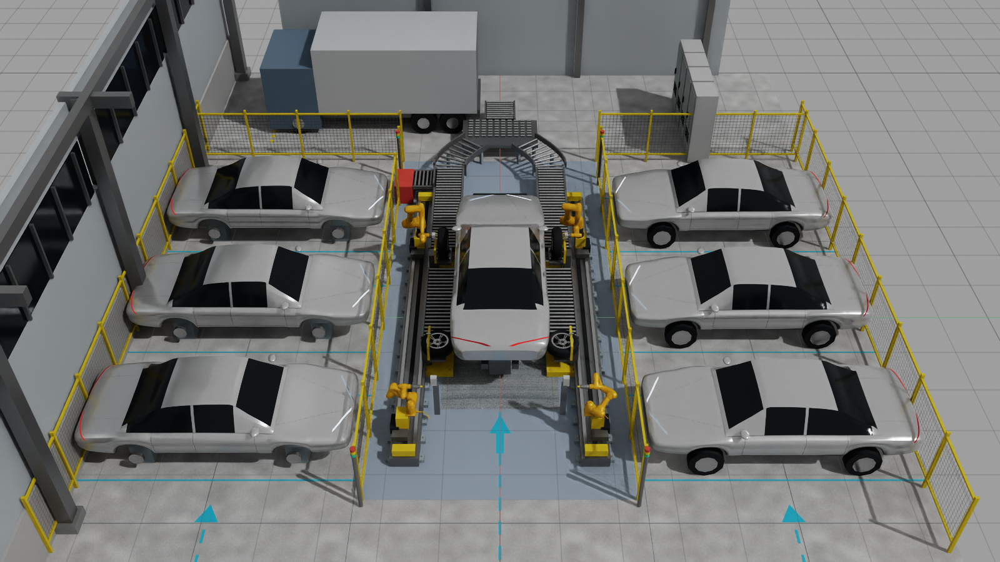
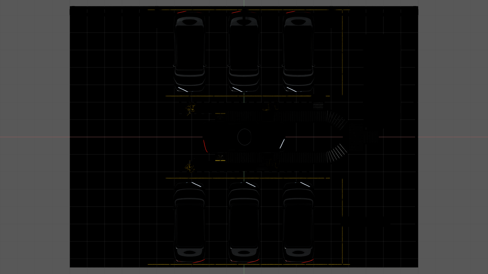
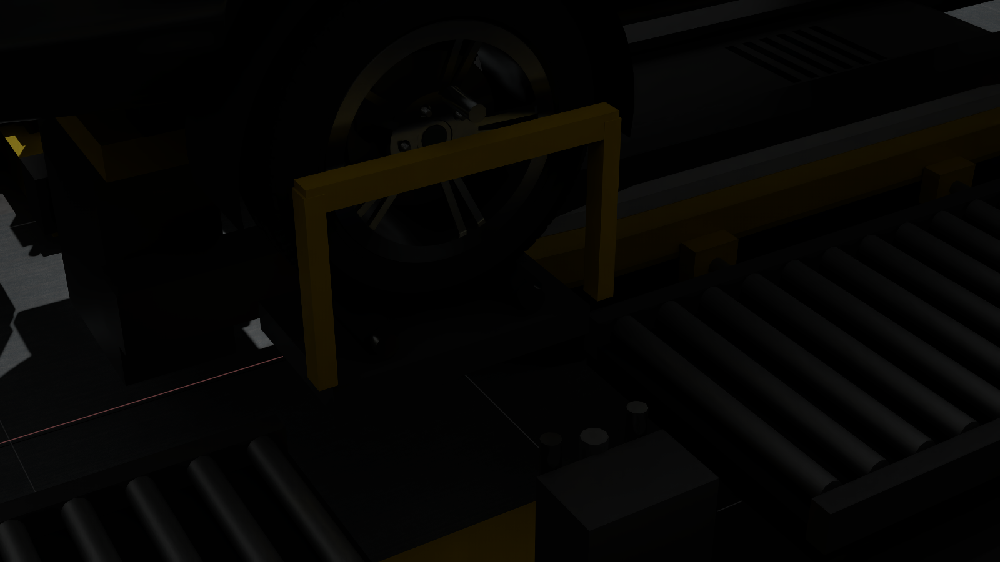
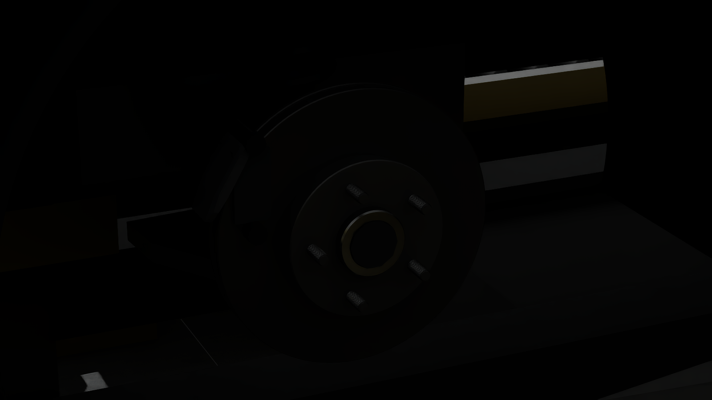

# CN7 휠 조립 셀 — 작업 기록 (2026-11-25)

목표: 금요일(11/27)까지 **실제 PhysX 물리로 동작하는** 자동차 휠 체결 맵 완성.
참고 배치도(`/home/rokey/project/image.png`)와 같은 구성입니다. 트럭은 이번 범위에서 제외합니다.

## 1. 현재 맵 상태

| 오버뷰 (40 s) | 조립 셀 (45 s) |
|---|---|
|  |  |

| 탑뷰 (40 s, 조명 부족) | 휠 디테일 (60 s) | 허브 디테일 (20 s) |
|---|---|---|
|  |  |  |

배치도와 대응하는 요소:

| 배치도 | 맵 |
|---|---|
| 타이어 공급 라인 좌/우 | `factory/conveyor` (분기 S자 컨베이어, 장착 로봇 뒤 정지 위치까지) |
| 로봇팔 (타이어 장착) | 고정식 Kawasaki RS080N 좌우 각 1대 (`LeftMountRobot`, `RightMountRobot`), SCHUNK 트레드 클램프 |
| 로봇팔 (너트 체결) | 고정식 Kawasaki RS080N 좌우 각 1대 (`LeftFastenRobot`, `RightFastenRobot`), map_fasten 컴팩트 5축 헤드(235 mm) |
| AMR (자동 이송) | KUKA KMP1500급 AMR + 리프트 |
| 대기구역 / 출고구역 | `factory/vehicle_buffers` |

이미지 다시 찍기: `~/isaacsim/python.sh map/wheel_cell/capture.py map/scene/wheel_cell.usda map/docs/images Overview@40 ...`

### 고정식 장착·체결 로봇 배치 (2026-11-27)

차체 양쪽에 장착용과 체결용 RS080N을 한 대씩 배치해 총 네 대입니다. 장착용 베이스는 (−0.33, ±2.50, 0) m, 체결용은 (2.27, ±2.50, 0) m이고 같은 쪽 두 베이스의 중심 간격은 2.60 m입니다. 양쪽 베이스는 모두 차체를 향합니다. 주문별로 레일을 타던 이전 로봇과 좌우 로봇팔 레일은 제거했습니다. 타이어 컨베이어는 로봇 뒤 y ±3.80, 셀 펜스는 y ±5.25, 차량 버퍼 중심은 y ±9.69(`AMR_BAY_Y`)입니다. 배치·안전 근거는 [`RS080N_CELL_SAFETY.md`](RS080N_CELL_SAFETY.md)에 있습니다.

### 장착 → 이동 → 체결·장착 동시 진행 (2026-11-27)

차가 두 곳(차 중심 x −0.45 = 위치 A, x 2.27 = 위치 B)에 섭니다. 장착 로봇은 허브 x 0.91 한 곳만, 체결 로봇은 위치 B의 앞·뒤 허브(x 3.63, 0.91) 가운데에서 두 곳을 맡습니다.

**셀 전체 −x 0.45 m 이동 (`DOCK_X`):** 처음 배치(위치 A = x 0)에서는 위치 B의 앞범퍼(x 5.08)와 타이어 분기 굽은 컨베이어 벨트 가장자리(x 5.16) 사이가 9 cm였습니다. 도킹 위치·로봇 네 대·타이어 정지 위치·너트 공급대·도킹 판을 함께 0.45 m 옮겨 이 간격을 0.54 m로 넓혔습니다(ISO 13854 몸통 끼임 최소 간격 500 mm). 서로의 거리는 그대로라 IK와 시간표는 바뀌지 않습니다. 트럭·분기 컨베이어·펜스는 그대로입니다.

| 순서 | 위치 | 앞바퀴 | 뒷바퀴 | 1번 주문 시각 (s) |
|---|---|---|---|---|
| ① | A | 장착(스터드에 걸기) | — | 45.5 |
| ② | A → B | 걸린 채 이동 (`INDEX_TRAVEL` 6 s) | — | 49.7 → 55.7 |
| ③ | B | 체결 | 장착 (동시) | 57.7 / 60.3 |
| ④ | B | — | 체결 | 69.7 |
| ⑤ | 출발 | | | 82.2 |

- 앞바퀴 장착부터 출발까지 57.3 s → 36.7 s(-20.6 s). `process.schedule` 계산값입니다.
- **이동 중 바퀴 고정:** 너트 없이 스터드에 걸린 앞바퀴가 이동 중 빠지지 않게 하는 것은 팀에서 따로 맡기로 했습니다(2026-11-27). 이 모델에는 고정 장치나 가속 제한이 없습니다.
- 뒷바퀴는 같은 컨베이어에서 앞바퀴를 바로 따라오고, 정지 위치보다 0.90 m 앞(`QUEUE_GAP`)에서 기다렸다가 앞바퀴를 들어 올린 뒤 정지 위치로 들어옵니다.
- 같은 쪽 장착·체결 팔의 링크 중심선 간 최소 거리는 0.69 m입니다(③에서 0.1 s 간격 계산). 링크 외형 간섭은 충돌 형상(3번 작업)으로 다시 확인해야 합니다.

### RS080N 장착·체결 동작 키프레임 (2026-11-27)

네 팔이 키프레임 시연에서 움직입니다. 관절 계획은 `wheel_cell/cell_motion.py`(numpy만 사용, RS080N URDF IK)에 있고 `build.py`가 링크 자세로 옮깁니다.

| 단계 | 장착 RS080N (x −0.33) | 체결 RS080N (x 2.27) |
|---|---|---|
| 준비 | 장착 8.5 s 전 대기 자세에서 출발, 몸을 돌려 컨베이어 위로 | 체결 5 s 전 출발 |
| 집기 | 장착 5.3 s 전 누운 바퀴를 위에서 PHL-W 슈로 잡음 (그리퍼 기준 0.32 m) | 체결 2 s 전 너트 공급대 (x 3.17, y ±1.45, z 1.135)에서 너트 5개 |
| 옮기기 | 들어 올린 뒤 돌려 바퀴 축을 허브 축에 맞춤, 허브 0.25 m → 0.03 m 앞 | 허브 0.08 m 앞으로 |
| 작업 | 장착 시각에 스터드에 걸고 0.6 s 뒤 놓음, 0.15 m 빠진 뒤 4.2 s에 대기 | 기존 체결 시간표(물림 2.45 s, 런다운 0.75 s, 최종 0.6 s) |

- **바퀴 정지 위치 x 0.27 (`PICK_X`, 허브 −0.64 m):** 허브 축 위치에서는 누운 바퀴가 팔 도달 거리 밖입니다(IK 해가 팔을 뒤로 젖힌 가지로만 나오고 J2 한계까지 1~3°). 허브에서 베이스 쪽으로 0.64 m 떨어진 곳에서 관절 여유가 20° 이상입니다(허브 기준 0.50~0.80 m 스캔). 공급 컨베이어 직선 끝을 x −0.05로 늘렸고, 차축 사이에 있던 짧은 이송 컨베이어(`AxleTransfer`)는 삭제했습니다.
- 8가지 동작(좌우 × 앞뒤 × 장착/체결)에서 관절 한계 여유는 최소 15°, URDF 최고 속도 대비 시간 여유는 1.8배 이상입니다.
- 레일 시절의 받침 지그(`LoadSupport`)는 삭제했습니다. 장착 뒤 바퀴는 스터드에 걸린 상태로 체결을 기다립니다([`HANDOVER.md`](../wheel_cell/HANDOVER.md)).
- **체결 헤드 = map_fasten 컴팩트 5축 헤드 (2026-11-27, `e32662d`):** 셀의 체결 헤드를 QST50-150CT 기준 464 mm에서 map_fasten `build_head`의 235 mm(플랜지 어댑터 r 55 mm, 본판 r 81 mm, 하우징 r 20 mm, 소켓 끝 = TCP)로 바꿨습니다. 준비 위치는 map_fasten과 같이 너트 끝에서 80 mm입니다. 기록(`production.sqlite3`)에 map_fasten 단계에 맞춘 `tool_aligned`(중심·축·5너트 패턴 정렬), `engaged`(스터드 끝 진입), `released`(소켓 분리) 이벤트를 넣었습니다. 회전 속도와 시간표는 셀 값(런다운 0.75 s)을 유지합니다. map_fasten 시험은 720°/s로 돌립니다.
- 아직 없는 것: 그리퍼 조 열고 닫기 동작, 팔 충돌 형상과 동작 중 간섭 검사, 라이브 물리(`live_robot.py`) 이전.

## 2. 장면 분할 구조 (USD 레이어)

빌드 결과를 한 파일(18 MB)이 아닌 **루트 1개 + 영역별 서브레이어 14개**로 만듭니다.
Isaac Sim에서 `map/scene/wheel_cell.usda`를 열면 Layer 패널에서 영역별로 켜고 끄거나 편집할 수 있습니다.

```
map/scene/
├── wheel_cell.usda              # 루트: 스테이지 메타데이터 + 서브레이어 목록
├── overrides/*.usda             # 손으로 편집하는 레이어 (빌드가 덮어쓰지 않음, 가장 강함)
├── concrete.png
├── shared/asset_library.usdc    # 로봇 링크·휠·차체 공용 메시 (17 MB)
├── shared/materials.usdc        # /Looks 재질
├── environment/lighting_cameras.usdc
├── factory/
│   ├── building.usdc  floor.usdc  conveyor.usdc  mount_robots.usdc  fasten_robots.usdc
│   ├── safety.usdc    vehicle_buffers.usdc  truck.usdc
└── orders/CN7_001.usdc … CN7_004.usdc   # 차량별 공정(AMR·로봇·휠 키프레임)
```

- 분할 코드: `map/wheel_cell/split_scene.py`. `build.py`가 빌드 마지막에 자동으로 호출합니다.
- 검증: 분할 전 단일 파일과 비교해 프림 5,100개, 속성 81,009개, 관계와 타임샘플이 모두 일치했습니다. 차이는 텍스처 경로 1개뿐인데, 복사한 같은 파일을 가리킵니다.
- 이제 `launch.py`, `check_physics.py`가 기본으로 `map/scene/wheel_cell.usda`를 엽니다.
- 나눠서 작업하는 방법은 [`map/scene/README.md`](../scene/README.md)를 보세요.
- 용어는 [`GLOSSARY.md`](GLOSSARY.md)로 통일합니다.
- 공정 시나리오와 현재 구현의 차이는 [`PROCESS_SCENARIO.md`](PROCESS_SCENARIO.md)를 보세요.

## 3. 변경 사항

| 파일 | 내용 |
|---|---|
| `visuals.py` | `isaacpjt` 원본 에셋이 없을 때 `assets/tire_example.usda`와 `assets/d455_tool.usda`를 대신 씁니다. |
| `assets/tire_example.usda`, `assets/d455_tool.usda` | 기존 빌드 결과에서 복원한 메시입니다. 다시 빌드한 결과가 원본과 일치했습니다(오차 0). |
| `physics.py` 기립 지그 | 두 턱을 **랙·피니언 조인트로 동기화**했습니다(SCHUNK PHL 방식). |
| `physics.py` 스핀들 | 인계 때 휠을 **삽입 축 중심에 맞춰** 고정합니다. |
| `physics.py` 로봇 | 타이어 장착 로봇이 시계 대신 **공정 상태에 맞춰** 움직입니다. 대기 자세에서 기다렸다가 삽입이 끝나면 안전 자세로 빠집니다. |
| `conveyor.py` 지그 대기 | 인계 후 지그를 세운 채로 축 쪽으로 물려서 낮추고, 턱을 닫습니다. |
| `split_scene.py`, `build.py` | 장면을 레이어로 분할합니다. |
| `capture.py` | 문서용 스크린샷을 렌더링합니다. |
| 디버그 | `CELL_DEBUG=1`, `CELL_DEBUG_TIP=<FL..>`, `CELL_DEBUG_JAW=<FL..>`를 켤 때만 진단 로그를 출력합니다. |

### 2026-11-26 AMR 차량 버퍼·KMP 1500 URDF (`ea2dfea`, `071e89b`, `e4f0ad2`)

pull 후 다시 빌드할 필요는 없습니다. `scene/factory/vehicle_buffers.usdc`가 이미 새로 생성돼 있습니다.

| 파일 | 내용 |
|---|---|
| `wheel_cell/build.py` `parking()` | 입고 칸 차의 받침대를 **바퀴 자리 4곳(Skid) → 차체 앞뒤 끝 4곳(`Stand_*`)** 으로 옮겼습니다. 차 밑에 AMR+행거가 옆으로 들어갈 통로가 생깁니다. 출고 칸도 같은 받침대 위에 차를 둡니다(타이어는 바닥에서 뜸). |
| `wheel_cell/process.py` | 새 상수 `BUFFER_SLOT_X`, `BUFFER_STAND_X/Y`, `BUFFER_CAR_Z`(칸의 차 높이 -0.09), `AMR_LIFT_ENTRY`(-0.12), `AMR_LIFT_CARRY`(-0.04). |
| `scene/factory/vehicle_buffers.usdc` | 위 변경으로 다시 생성한 레이어(이 레이어만 바뀜). Isaac 없이 usd-core로 만들어 crate 0.8 형식입니다. |
| `wheel_cell/assets/kmp1500.urdf`, `kmp1500_meshes/`, `kmp1500_urdf.py` | KUKA KMP 1500 URDF(데이터시트 크기). SICK S300 2개(대각선 `laser_front_left`/`laser_rear_right`), `imu_link`, 외관 메시. ROS/RViz·Nav2 테스트용이고 Isaac 장면은 그대로입니다. |
| `.gitignore` | `.envrc`, `.direnv/` 제외. `wood_table_steel_ball.usda` 삭제(쓰지 않던 파일). |
| `docs/PROCESS_SCENARIO.md` 1단계, `scene/README.md` "변경 기록" | AMR 픽업·반납 흐름, 받침대 위치·높이 표. |

AMR 흐름(정한 내용): 입고 칸은 **1 → 2 → 3**(통로 쪽부터) 꺼내고, 출고 칸은 **3 → 2 → 1**(먼 칸부터) 채웁니다. 차를 실은 채로는 다른 차 밑을 못 지나가서 빈 칸만 지나가게 하는 순서입니다. 회전은 통로 끝 (-7.5, ±`AMR_BAY_Y`)에서 제자리 90°입니다 (RS080N 배치로 버퍼 중심을 6.55 → 9.69로 옮김, 통로를 x -7 → -7.5로 옮겨 셀 모서리 신호등 기둥까지 0.45 m, 2026-11-27).

아직 안 된 것: Isaac 물리 검증(`check_physics.sh`), 키프레임 시연(주문 차량은 아직 통로 끝에서 실린 채 나타남), 주문 4대 중 4번째 차를 둘 칸.

### 2026-11-27 출고 쪽 바닥 확장 · AMR 주행 구역 바닥 표시

pull 후 다시 빌드할 필요는 없습니다. 바뀐 레이어 3개를 Isaac Sim 5.1.0(IsaacSim04)의 `build.sh`로 만들어 넣었습니다(crate 0.9).
같은 PC에서 바꾸기 전 코드로 빌드한 결과가 main의 레이어와 똑같아서, 바뀐 3개만 이번 수정의 결과입니다.

| 파일 | 내용 |
|---|---|
| `wheel_cell/build.py` | 바닥 남쪽(출고 쪽) 끝 `FLOOR_S = FLOOR_Y + 8` → 바닥 y -18 ~ +10. 슬래브·콘크리트·줄눈·오른쪽 끝 벽을 새 끝까지 늘림 |
| `wheel_cell/build.py` `amr_zones()` | AMR 주행 구역 바닥 표시 `/World/AMRZone`: 연한 황토색 면(z 1.8 mm) + 노란 테두리(z 4 mm). 통로 띠(x `AMR_GATE_X` -7.5 ± 2.455), 입고·출고 칸 줄 띠(칸 3 끝까지), 통로 양 끝 회전 원(반지름 2.68 m = 실은 차 대각선 절반 + 0.1 m). 표시만 있고 충돌체 없음 |
| `wheel_cell/split_scene.py` | `AMRZone`을 `factory/floor` 레이어로 보냄 (없으면 `factory/misc`가 새로 생김) |
| `scene/factory/floor.usdc`, `building.usdc`, `shared/materials.usdc` | 위 변경으로 다시 생성 |

## 4. 에러 기록 (발생 순서)

모든 물리 결과는 `./map/wheel_cell/check_physics.sh --seed 42` 기준입니다.

### E1. 빌드 실패: 에셋 파일 없음 — ✅ 해결
```
FileNotFoundError: Set --asset-root to isaacpjt. Missing:
  ~/cobot3_ws/isaacpjt/M0609/robot/m0609_rg2_d455_edit.usd
  ~/cobot3_ws/isaacpjt/Factory/CN7/tire_example/tire_example.usd
```
- **원인:** 원래 빌드하던 PC의 에셋이 이 PC에는 없습니다(`Factory/` 폴더 자체가 없음).
- **조치:** 기존 `wheel_cell.usdc`에 베이크된 메시를 복원해 `assets/`에 넣고, 원본이 없으면 이 파일을 쓰게 했습니다.

### E2. 4개 스테이션 모두 `grip_slip` (기립 중 46 mm 미끄러짐) — ✅ 해결
```
FL/FR/RL/RR: result=grip_slip, grip_slip_mm≈46, tip_handoff=false
```
- **원인:** 패드 마찰 문제가 아니었습니다. 두 턱 드라이브가 650 N 한계에서 서로 밀고 있어서 **턱 쌍의 중심을 잡아주는 힘이 없었습니다.** 지그를 기울이면 휠과 턱이 한 덩어리로 턱 축을 따라 −40 mm에서 +42 mm까지 흘렀습니다(디버그 로그 `d=(0,-40.4,0)`).
- **조치:** `PhysxPhysicsRackAndPinionJoint`로 두 턱을 피니언 하나에 묶었습니다.
- **결과:** 미끄러짐이 **46 mm에서 0.5 mm**로 줄었고, 4개 스테이션 모두 기립과 인계에 성공했습니다.

### E3. 타이어 장착 로봇이 휠에 충돌 (`equipment_contact`) — ✅ 해결
```
CONTACTDBG RightMount/Link_6/GuideGripper  ↔  FR/Wheel/Web_32   (침투 1.0 mm)
```
- **원인:** 로봇 키프레임은 리플레이용이라 "로봇이 휠을 들고 허브까지 간다"는 동작이에요. 라이브에서는 셔틀 프레스가 휠을 밀어 넣습니다. 그래서 정해진 시간에 움직인 로봇 그리퍼가 공급 위치에 있던 휠에 먼저 박혔습니다.
- **조치:** 타이어 장착 로봇은 휠 바깥 대기 자세에서 기다립니다. 해당 축 삽입이 끝나면 관절 공간에서 2초 동안 안전 자세로 빠져나옵니다(`Robot.advance`).

### E4. 로봇이 대기 중인 기립 지그를 밀어 삽입 경로를 막음 — ✅ 해결
```
INSERTDBG FL ... /World/Live/FL/TipJawA/RubberPad   (삽입 내내 접촉)
JAWDBG aligned 26.75→28.75s  tool x 1.82 → 1.41
```
- **원인:** 지그가 수평 자세로 x 1.82에서 대기했습니다. AMR이 도킹하자 타이어 장착 로봇 레일 캐리지가 x 1.89로 들어오며 지그를 밀었고, 턱 빔이 허브와 휠 사이에 끼었습니다.
- **조치:** 지그를 세운 채로 축 쪽(x −0.07)으로 물리고, 0.2 m 낮춘 뒤 턱을 닫습니다.

### E5. 스터드 걸림 (`jammed`, 허브 30 mm 앞) — ✅ 해결
```
CENTERDBG FL gap 29.9 mm  center_mm 1.118  → Stud_0..4 접촉
```
- **원인:** 인계 때 스핀들이 휠의 실제 위치를 그대로 고정했습니다. 인계 기준이 6 mm 오차까지 허용하기 때문이에요. 그래서 휠이 허브 축에서 1.1 mm 어긋났고, 스터드와 구멍 사이 여유 0.7 mm를 넘어 스터드 끝에서 걸렸습니다.
- **조치:** 스핀들이 휠을 삽입 축 중심에 고정합니다(실제 스핀들의 파일럿 센터링과 같은 방식).
- **결과:** 중심 오차가 **1.1 mm에서 0.28 mm**로 줄었습니다. FL은 스터드를 통과해 **장착면 3.9 mm 앞**까지 들어갔고, RL은 11.9 mm 앞에서 멈췄습니다.

### E6. 시도했다가 되돌린 것: 지그를 더 낮게 대기 — ↩️ 되돌림
- 지그를 레일 안쪽(y 1.35)으로 넣고 0.28 m 낮추면, 셔틀 크래들(포크와 롤러)이 지그 턱 패드에 걸려 셔틀이 움직이지 못했습니다.
```
SHUTTLEDBG FL/Shuttle/Cradle/Visual/Fork ↔ FL/TipJawB/RubberPad
```
- E4의 대기 위치로 되돌렸습니다.

### E7. 마지막 수 mm에서 안착하지 못함 (결합구역 문제 1) — ✅ 해결 (2026-11-25)
하나씩 고치고 테스트한 순서입니다.

| # | 원인 (진단 근거) | 변경 하나 | 결과 |
|---|---|---|---|
| 7-1 | FL이 막힌 게 아니라 파일럿 구간에서 천천히 들어가는 중에 8초 제한에 걸림 (마지막 1초 동안 5.8 → 3.9 mm) | `INSERT_TIMEOUT` 8 → 12초 | 2.84 mm에서 **완전 정지**. 진짜 원인이 드러남 (유지) |
| 7-2 | 도킹한 차체가 고무 패드에 0.3 mm 내려앉아, 고정 스핀들 축과 허브 축이 **0.28 mm** 어긋남. 보어–파일럿 여유는 0.05 mm라 마찰로 정지 | **플로팅 스핀들**: 반경 ±1.5 mm, 4×10⁵ N/m, 휠 무게 보정 | FL·RL **seated** (중심 오차 0.27 → 0.05 mm). 대신 FR 정렬 실패가 새로 생김 |
| 7-3 | 플로트 때문에 FR 타이어가 크래들 받침 롤러(고정 충돌체, 고무 마찰 0.82)에 닿아 회전이 −0.6°에서 묶임 | 받침 롤러에 아이들러 마찰 0.02 (`IdlerRoller`) | 4개 스테이션 모두 정렬 성공 |
| 7-4 | seed 123에서 FL이 12 mm 앞에서 정지. 32각형 타이어 충돌 형상이 각도에 따라 롤러에 최대 1.5 mm 다르게 닿아 휠을 0.9 mm 들어 올림 | 크래들 롤러 틈 `CRADLE_CLEARANCE` 2.5 mm | seed 42 / 7 / 123 모두 FL·RL **seated** |

- 고장 검출 회귀 시험 `--jam`(FL 지그 2 mm 오차): FL은 기대대로 `jammed`가 나옵니다.

### E8. 고장 뒤 다른 스테이션이 어긋난 차체에 삽입 (인터록) — ⚠️ 부분 해결 (2026-11-25)
- **증상:** `--jam`에서 FL이 막히면 FL 프레스가 차체를 밀어 `dock_lost`가 나고, 그 뒤 RL이 허브가 12.4 mm 어긋난 채 삽입을 시작해 실패했어요.
- **변경 (유지):** `INTERLOCK_FAULTS = {jammed, dock_lost}`. 어느 스테이션이든 이 상태가 되면, 아직 삽입 전인 스테이션은 새 종료 상태 `interlocked`로 멈춰요. 로봇 간섭(`interference`)은 해당 쪽 로봇만 멈추는 별도 안전 정지라 조건에서 뺐어요.
- **결과:** 고장이 판정된 뒤에는 RL이 `interlocked`로 멈춰요. 정상 실행(seed 42)에서는 FL·RL `seated`로 변화가 없어요.
- **한계:** FL 막힘은 12초 시간 제한이 지나야 판정돼서, 그 전에 RL이 삽입을 시작하면 인터록이 늦어요.
- **되돌린 시도:** "1.5초 동안 0.5 mm도 들어가지 않으면 `jammed`"로 빨리 판정하게 했더니, 정상 삽입(seed 7)에서 파일럿 입구의 중심 맞춤 대기까지 고장으로 판정했어요. 그래서 되돌렸어요.

### E9. 파일럿 진입 불안정 (실행마다 결과가 다름) — 🔍 진행 중
- 같은 seed 7로 돌려도 한 번은 FL·RL `seated`, 다른 한 번은 12~14 mm에서 `jammed`였어요. CPU PhysX 멀티스레드 계산 때문에 실행마다 미세하게 달라져요.
- **원인 추정:** 휠 센터 구멍과 허브 파일럿 사이 반경 여유가 0.05 mm인데, 모델의 파일럿 끝은 모따기 없는 직각 원통이에요. 조금만 어긋나도 구멍 테두리가 파일럿 끝 모서리에 걸려요.
- **시도 1 (되돌림):** 파일럿 끝에 1.5 mm × 45° 모따기를 넣었어요. seed 42와 seed 7(1회차)은 seated였지만, seed 7(2회차)은 FL이 12.8 mm에서 `jammed`였어요. seed 123에서는 PhysX 오류 `PxD6Joint::setDrivePosition: pose invalid`와 함께 FL이 허브를 51 mm 관통하고 RL이 `dock_lost`가 됐어요. 나아졌다고 볼 수 없어서 되돌렸어요.
- **새로 찾은 버그:** 정렬 중 휠 각도(`Station.step`의 `angle`)가 가끔 `nan`이 돼요(FR 디버그 로그). 이 값이 스핀들 목표로 들어가면 위 PhysX 오류가 나고 시뮬레이션이 무너져요. 다음 작업 1순위예요.

### E10. 휠 각도 NaN (E9 원인) — ✅ 해결 (2026-11-26, `f40f91f`)
- **원인:** 도킹 전 차체 좌표계로 쓰던 `Gf.Rotation()`은 단위 회전이 아니라 **초기화되지 않은 메모리**예요(2만 번 중 1번꼴로 쓰레기 값). 핸드오프(7.5 s)가 도킹 전이라, 가끔 휠 각도가 NaN이 되어 스핀들 목표로 들어갔어요 → `PxD6Joint::setDrivePosition: pose invalid`, 로봇 추적 오차 최대 3.9 m.
- **조치:** 명시적 단위 회전 `rotate((0,0,1),0.)`.
- **결과:** PhysX 오류 0건. 같은 seed는 매번 같은 결과(결정적). E9의 "실행마다 다름"도 이것이 원인으로 보여요.

### E11. 타이어 장착 로봇이 세워 둔 팁 지그에 닿음 (뒷바퀴 접근) — ✅ 해결 (`fa4b6a6`)
- **원인:** 대기 자세에서 플랜지가 축 위치에 있어, 툴 부품(±0.062 m)이 접어 둔 지그의 위쪽 턱 머리(x ≤ 축+0.003, z 1.14–1.22)를 스쳤어요. 실제 로봇은 레일을 따라오며 목표보다 x로 약 +0.06 m 늦어요.
- **조치:** 대기 목표를 축 +0.06 m(턱 머리와 세운 가이드 빔 사이)로.
- **되돌린 시도:** 대기 3 cm 바깥쪽 / 지그 3 cm 낮게 접기 / 대기 9 cm 높게 / 대기 +0.12 m(`--jam`에서 빔 접촉).
- **결과:** seed 1–13, 42, 123 모두 4륜 seated, `--jam`은 FL `jammed`.

### E12. 물러날 때 뒷바퀴 지그 빔 접촉 — 🔍 남음
- `check_physics`가 이제 장착 로봇 주차까지 시뮬레이션해요(`5dbc3cf`). 그러자 모든 seed에서 ~48.8 s에 물러나는 로봇(카메라 하우징 또는 Link_5)이 뒷바퀴 세운 빔(축+0.30 m, 꼭대기 z 1.32)에 1–3 mm 닿아요. 4륜은 이미 seated.
- **되돌린 시도 1:** 뒷바퀴 뒤 안전 자세 0.2 m 높이기 → Link_5가 빔에 닿음 (Link_5 충돌 형상이 손목 중심보다 ~0.2 m 아래까지 내려옴).
- **되돌린 시도 2:** 손목 z 1.59(0.30 m 높이기) → 로봇 접촉은 0건. 그런데 seed 42·7이 exit 1: 두 레일이 주차로 움직이기 시작하는 순간(로봇 시계 ≈ 22.8 s) 차체가 ~1 s 동안 −y로 8.4 mm 밀려 클램프 1개가 떨어지고 도킹이 풀림. 그동안 차체에 닿은 것은 바퀴–허브뿐이고 로봇–차체 접촉은 없었음. 힘이 어디서 전달되는지는 미확인(다음 조사 대상).

### E13. 파일럿 모따기 시도 2 — ↩️ 되돌림
- NaN 수정 후 다시 시도(우민우 버전 치수 1.6 × 1.4 mm). 2 mm 어긋난 휠도 모따기를 타고 들어가며 플로팅 스핀들 반력이 차체를 밀어 도킹 클램프(−y쪽 2개) 접촉이 끊겼어요 → `dock_lost`, `--jam` 고장 검출 실패. 우리 플로팅 스핀들 구조에서는 모따기 반력을 받을 곳이 없어요.
- 현재 씬에서는 15개 seed 모두 jam 없이 seated라, 파일럿 진입 문제는 재현 케이스가 없어요.

## 5. 현재 결과 (2026-11-26)

| 검사 | 결과 |
|---|---|
| seed 1–13, 42, 123 | 4륜 seated (마지막 안착 ≈ 46 s) |
| `--jam` (seed 42) | FL `jammed`, 나머지 seated |
| 주차까지 연장 검사 | 모든 seed에서 E12 접촉 1건 |

## 6. 남은 문제 (다음 작업, 하나씩)

1. **E12 물러날 때 빔 접촉:** 빔을 접는 방식 변경 또는 물러날 때 먼저 레일 쪽(+y)으로 빼기.
2. **도킹 판정이 너무 빡빡함:** 클램프 4개가 매 프레임 접촉해야 해서, 차체가 조금만 밀려도 즉시 `dock_lost`.
3. **로봇 미리 배치(B):** E12 해결 후 다시 적용(마지막 안착 ≈ 38 s 기대).
4. **인터록 조기 감지 (E8 한계)**
5. **볼트 체결 물리:** 5축 너트러너는 키프레임 시연만 있어요.
6. **탑뷰와 세부 카메라 조명**

## 7. 실행 방법

```bash
cd ~/project
./map/wheel_cell/build.sh                         # 빌드 + 레이어 분할
./map/wheel_cell/run.sh --assembly --seed 42      # 라이브 물리 (창에서 Play)
./map/wheel_cell/run.sh --replay                  # 키프레임 시연
CELL_DEBUG=1 ./map/wheel_cell/check_physics.sh --seed 42   # 헤드리스 검증 + 진단 로그
```
