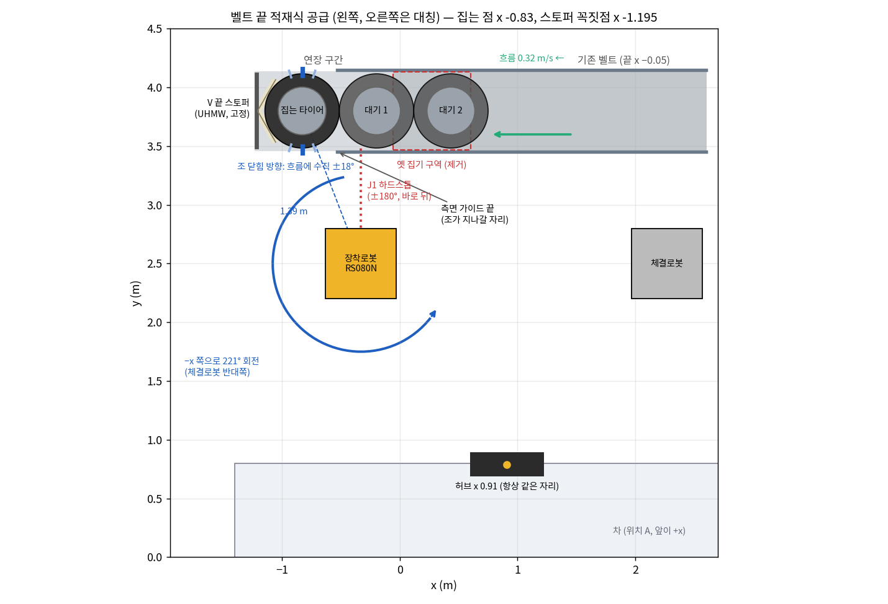

# 조립 셀 통합 (`scene/wheel_cell.usda` 라이브 물리)

`wheel_mount_sim`에서 검증한 **장착로봇과 장착 관련 물리**를 조립 셀의 라이브 물리(`wheel_cell/run.sh` → CN7 | Live PhysX)에
넣었다. 셀의 배치·디자인(로봇 베이스, 집기 구역, 허브 위치, 컨베이어, 키프레임 시연)은 바꾸지 않았다.

## 무엇이 어디서 바뀌나

`scene/wheel_cell.usda` 파일 자체에는 물리가 없다(강체·관절·충돌체 0개, 키프레임 시연만 있음). 물리는 라이브 실행 때
`wheel_cell/cell.py`가 장면 위에 만든다. 통합은 그 시점에 `wheel_mount_sim/cell_mount.py`의 `install()`을 부르는 방식이다.

| 대상 | 셀 원래 | 통합 후 (wheel_mount_sim) |
|---|---|---|
| 장착로봇 | 라이브에 없음 (옛 레일 경로를 찾아 생성되지 않음) | RS080N 관절체 + SCHUNK PHL-W 63-080-S, 좌우 각 1대, 셀 베이스 (`process.MOUNT_BASE_X`, ±`ROBOT_BASE_Y`, 0)·차를 향함 (값을 그대로 따라감), 시작 자세 = 셀 `PARK` |
| 키프레임 장착로봇 시각 모델 | 라이브에도 보임 | 라이브 장면에서만 끔 (같은 자리에 물리 로봇이 섬) |
| 그리퍼 | 시각용 상자 (`build.mount_gripper`) | 조 2개(랙·피니언 미믹 동기), 우레탄 슈 수평 아래 10°, 손가락·립 충돌체, 공압 힘 4,630 N |
| 허브 파일럿 | 원통 기본 도형, 접촉 오프셋 0.8 mm | 144각형 프리즘(시드별 공차 지름 유지), 오프셋 0.8 mm (셀 시험대 76 mm/s 기준) |
| 허브면·스터드 재질 | Steel 0.27 | 우리 강 재질 (휠 장착면 알루미늄 0.61/0.47과 맞물림) |
| 허브면 반지름 | 79 mm (`fitment.FLANGE_RADIUS`) | 69 mm (`params.FLANGE_R`, 확정값: [`assets/README.md`](../../assets/README.md#값-대조-결과)) |
| 허브면 접촉 오프셋 | 0.8 mm | 0.2 mm |
| 베어링 | 반경 유격 0.03 mm, 끌림 1.2 N·m | 유격 0 (사전 예압), 끌림 0.75 N·m |
| 서스펜션 | 22 N/mm, 예압 6 mm | 23.2 N/mm (승차 진동수 계산), 예압 300 N |
| 휠 장착면 | 셀 CAD 삼각형, Steel 0.27 | **같은 삼각형** + 허브 쪽 보어 모따기 1.5 mm, 알루미늄 마찰, 오프셋 0.045 mm |
| 링 타이어 | 반경 210 / 횡 140 N/mm, 비틀림 55 N·m/° (추정) | 반경 180 / 횡 65 N/mm, 비틀림 139 N·m/° (실측 평균 문헌값과 계산) |

근거는 [`../params.py`](../params.py)·[`../PARAMS_table.md`](../PARAMS_table.md), 이 값으로 바꾼 이유는
[`troubleshooting/`](troubleshooting/장착로봇팔_트러블슈팅.md) TS-12~15.

## 끄고 켜기

- 기본은 켜짐. 셀 원래 물리로 비교하려면 `CELL_MOUNT_SIM=0 ./wheel_cell/run.sh ...`
- 로봇 USD는 커밋하지 않으므로 처음 한 번 `./wheel_mount_sim/tools/fetch_assets.sh` (없으면 셀 실행 시 안내 오류).

## 통합 당시 검증 기록 (2026-11-27)

| 검사 | 명령 | 결과 |
|---|---|---|
| 셀 안 장착로봇 대기 | `./wheel_mount_sim/cell_check.sh --seconds 8` | 좌우 플랜지가 `PARK` 순기구학과 0.011 mm 차이로 유지, 다른 설비 접촉 0 → PASS. 팀원이 셀을 0.45 m 옮긴 뒤(ce8ad6d)에도 베이스가 `process.py` 값을 따라 x −0.33으로 이동해 PASS |
| 배치 일치 | 셀 키프레임 로봇(`robot.Arm` + 셀 URDF)의 `PARK` 플랜지와 비교 | 둘 다 (0.12, ±2.1228, 2.1587) m, 같음 |
| 셀 회귀 | `python3 wheel_cell/regress.py` (켬/끔 비교) | 켬·끔 결과 같음: 삽입 시험대 2, 공급 2, 버퍼 2 통과. 전체 흐름 5종(`seed42`, `gate×4`)은 **끔에서도** `feed_failed` → 팀원 배치 변경 뒤의 기존 문제 |
| 단독 시뮬레이션 | `run.py --fast`, `run.py` | 둘 다 `mounted` (22.3 s / 기본) |

## A/B/C 연동 범위

[공정 시나리오](../../docs/PROCESS_SCENARIO.md)의 고정 장착 작업점에서 A의 전륜과 B의 후륜을 반복 처리한다. 장착 로봇은 가조립 유지 확인 후 그리퍼를 놓고 후퇴한다. 베이스와 명목 작업점은 셀의 [배치 설정](../../wheel_cell/process.py)을 참고한다.

장착 측 라이브 연동의 완료 기준은 고정 픽업·작업점에서 파지·정렬·삽입·해제·후퇴를 진행하고, 휠 유지와 안전 후퇴 결과를 공정 제어에 넘기는 것이다. B의 전륜 체결과 후륜 장착을 병렬로 실행하며, 차량을 인덱싱하는 동안 휠이 허브에 남는지 검증해야 한다. 위 단독·대기 시험 결과와 통합 공정 완료는 별도 판정으로 관리한다.
## 벨트 끝 적재식 공급 (2026-11-27)



팀 장면 `scene/`의 공장 수정 레이어 `scene/overrides/factory.usda`(장면을 다시 빌드해도 남음)에 벨트 연장과 끝 스토퍼를 넣었다.
값은 `cell_layout.py`, USD는 `./wheel_mount_sim/tools/pxrpy.sh wheel_mount_sim/tools/extend_belt_end.py`로 다시 쓴다 (몇 번 돌려도 같은 결과).
라이브 물리(`wheel_cell/cell.py` → `cell_layout.pre_build`)는 장면에 끝 스토퍼(`/World/Factory/LeftAccumEnd`)가 있으면 집기 구역 대신 끝 스토퍼를 쓴다.
키프레임 시연(타임라인 재생)은 아직 옛 흐름(x 0.27에서 집기) 그대로다.

| 항목 | 이전 팀 셀 | 지금 |
|---|---|---|
| 집기 | 벨트 중간 집기 구역 (V 스토퍼, 광전 센서 S1·S2, 센터링 암, 리프트 바), x 0.27 | **없앰** |
| 벨트 끝 | x −0.05 | x −1.23까지 연장 (롤러 11개·베드·측면 레일·다리를 팀 벨트와 같은 규격으로) |
| 스토퍼 | 집기 구역의 스프링 V | 벨트 끝 **고정 V 스토퍼** 하나 (UHMW 판 120°, 강 브래킷) |
| 공급 | 한 개씩 집기 구역에서 정렬·들어 올림 | 롤러가 계속 돌고, 타이어가 누운 채 끝에서부터 맞닿아 쌓임 |
| 집는 곳 | — | 항상 같은 자리: 맨 앞 타이어 중심 x −0.83 (베이스에서 −x로 0.50 m, 뒤로 1.30 m) |
| 측면 가이드(높이 100 mm) | 벨트 끝까지 | x −0.53에서 끝 (조가 흐름에 수직 ±18°로 내려올 자리) |
| 집기 신호 | S2 | V 안 확산형 광전 센서 1개 + 정지 0.5 s → `pick_ready`, 뒤 타이어는 `queued` |

집는 자리는 계산으로 정했다 (`analysis/cell_reach.py`, RS080N 셀 베이스 방향 그대로):

- J1 하드스톱(±180°)이 로봇 바로 뒤(벨트 쪽)를 향한다. 그래서 집은 뒤 허브로 가는 회전은 **−x 쪽(체결로봇 반대쪽)으로만** 가능하다 (221°). 설계 의도와 같다.
- 집는 자리를 −x로 0.30 / 0.40 / 0.50 / 0.60 m 옮기면 J1 여유가 10.4 / 12.5 / **18.8** / 22.8°다. 팀 기준(15° 이상)을 넘는 가장 가까운 자리로 0.50 m를 골랐다. J2·J3·J5 여유는 44° 이상이다.

### 확인 (`CELL_CHECK_SCRIPT=cell_feed_check.py ./wheel_mount_sim/cell_check.sh --seconds 30`)

| 항목 | 결과 | 기준 |
|---|---|---|
| 맨 앞 타이어(FL·FR) `pick_ready` 시각 | 3.16 s, 3.11 s | 25 s 안 |
| 집는 자리 대비 흐름 방향 / 폭 방향 / 기울기 | −0.2 / −0.14 mm / 0.0° (FL), −0.95 / 1.33 mm / 0.0° (FR) | ±3 / ±2 mm / 1° (팀 집기 구역 기준) |
| 뒤 타이어(RL·RR) | `queued`, 앞 타이어와 629–630 mm 간격 (지름 632 mm, 트레드 눌림) | 맞닿아 대기 |
| 정상 줄 압력 (마지막 1 s 평균) | 타이어↔타이어 107–112 N, 스토퍼 224–232 N | 뒤 타이어 1개의 롤러 마찰 μ·m·g = 0.62–0.72 × 17.1 kg × 9.81 = 104–121 N과 일치 |
| 도착 충격 최대 | 스토퍼 537–622 N, 타이어↔타이어 538–808 N (한 스텝 값) | 참고 |
| 장착로봇 | 대기 자세, 접촉 0 | 접촉 0 |
| 팀 장면 영향 | 팀 장면에서 `cell_check` PASS, 삽입 시험대 PASS (전환 안 됨) | 변화 없음 |

주의: 맨 앞 타이어를 들 때 뒤 타이어가 약 110 N으로 트레드를 밀고 있다. 고무끼리 마찰(약 0.8)로 들 때 약 90 N이 더 걸린다. 그리퍼 유지력(2 × 4,630 N × 0.6 ≈ 5.6 kN)에 비하면 작지만, 뒤 타이어가 끌려 올라가지 않는지는 제어를 옮길 때 확인한다. 줄 압력을 없애야 하면 실제 라인처럼 무압 적재(구역마다 센서로 롤러 정지)로 바꿀 수 있다.

## 셀 안 장착 시뮬레이션 (AMR 이송 제외)

```bash
cd ~/cobot3_ws/map
~/isaacsim/python.sh wheel_mount_sim/cell_mount_run.py              # 좌우 동시, 단축 프로필, 영상 저장 (장면 30 s, 약 5분)
~/isaacsim/python.sh wheel_mount_sim/cell_mount_run.py --gui        # 창을 열고 실시간으로 보기
~/isaacsim/python.sh wheel_mount_sim/cell_mount_run.py --side left --no-video   # 한쪽만, 빠르게
~/isaacsim/python.sh wheel_mount_sim/cell_mount_run.py --basic      # 느린 시운전 프로필 (한 바퀴 65 s)
```

차는 위치 A에 고정(운동학 물체), AMR은 그 아래 세워 둠. 결과는 `wheel_mount_sim/output/cell/<시각>/`
(`summary.json`, `events.jsonl`, `trace_*.json`, 카메라 3개 GIF·PNG). 과정과 결과: 트러블슈팅 TS-18, TS-19 (한 바퀴 25.1 s, 양쪽 안착, 놓은 뒤 처짐 분석).

## 다음

장착 동작 제어는 아직 셀에 없다(로봇은 `PARK`를 유지). 셀 배치(벨트 끝 x −0.83에서 집기, −x 쪽으로 돌아 허브 x 0.91, 위치 A→B 이동)에 맞춰
`wheel_mount_sim/run.py`의 제어(비전 정렬, 힘 제어 삽입, 놓기·후퇴)를 셀용으로 옮기는 것이 다음 단계다.
