# 장착로봇팔 트러블슈팅

> 노션 「트러블슈팅 → 장착로봇팔」 페이지의 원본입니다. 이미지는 `media/` 폴더에 있습니다. 실행 코드는 `wheel_mount_sim/` 참고.
> 항목마다 **문제 → 원인 → 시도 → 결과(수치) → 결정**을 적고, 근거 자료를 붙입니다.

## 현재 상태 (2026-11-27)

| 항목 | 상태 |
|---|---|
| 장착로봇 | Kawasaki RS080N (가반하중 80 kg), 바닥 고정 — 결정 경위는 TS-09·TS-10 |
| 그리퍼 | SCHUNK PHL-W 63-080-S 2조 평행 트레드 클램프 |
| 바퀴 무게 | 17.1 kg (림 9.1 + 타이어 8.0)로 반영, 회귀 테스트 12/12 통과 |

---

## TS-03 (11/27) 그리퍼 레퍼런스 조사

| 레퍼런스 | 잡는 곳 | 비고 |
|---|---|---|
| BMW·IBG EP1645439A2 | 센터보어 안에서 벌림 + 헤드에 체결기 | BMW 허브는 파일럿 돌기 없음, 휠 볼트 체결 |
| 혼다 US9757828 | 타이어 트레드 | 카메라로 위상 측정 후 회전 |
| 미쓰비시 US4942659 / US5159745 | 타이어 바깥 둘레 클로 | 가운데에 너트러너 |
| Quatro US5125298 | 타이어 바깥 지름 패드 | 스핀들 5개 육각 배치 |
| 마쓰다 US5640750 | 센터핀 + 양옆 패드 | 구면 베어링으로 따라감 |

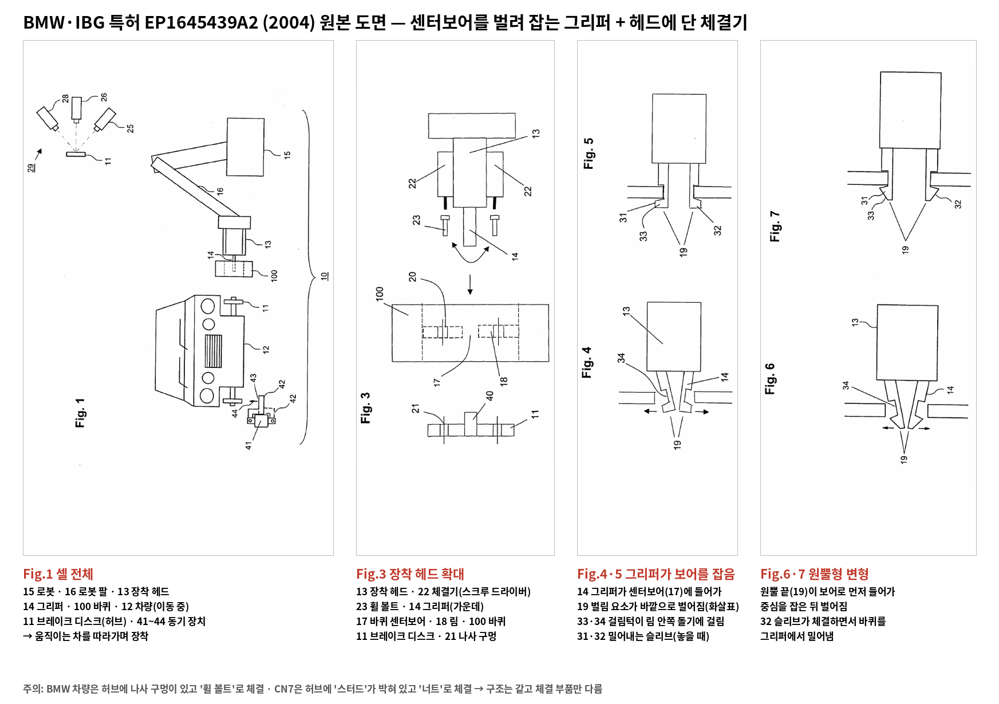

## TS-04 (11/27) 바퀴 실측 규격 확인 → 무게 수정

- **확인**: CN7 순정 16 × 6.5J ET46, 센터보어 Ø67.1, 5 × 114.3, M12 × 1.5 (순정 52910-AB200/AA230) → 모델과 일치.
- **변경**: 림 무게 7.88 → 9.1 kg (공개 자료 1곳, 무거운 쪽으로 채택). 바퀴 17.1 kg.
- **검증**: 장면 다시 빌드 후 전체 회귀 테스트 12/12 통과, 기준값 변화 없음.

---

## 시뮬레이션·백그라운드 작업 기록

| 일시 | 작업 | 결과 |
|---|---|---|
| 11/26 | `check_wheel_release.sh` (놓은 뒤 물리) | 1.45° 기울어 안정 |
| 11/27 10:15 | `wheel_cell/build.sh` (바퀴 17.1 kg 반영) | 417.6 s, 완료 |
| 11/27 10:22 | `regress.py` 전체 | 12/12 통과, 기준값 변화 없음 |

## TS-09 (11/27) 레일 교체 + 장착·체결 로봇 재선정 (제안)

- **요구 하중**: 장착 = 타이어 클로 공구 ~8.5 kg + 바퀴 17.1 kg ≈ 26 kg @ Z ~185 mm. 체결 = QST50 5.8 kg × 5 + 틀·플로팅·회전방지 ≈ 40~48 kg @ Z ~300 mm, 체결 반력 5 × 127 = 635 Nm는 헤드가 바퀴를 잡아 공구 안에서 상쇄해야 함.
- **결론(제안)**: 양쪽 모두 Kawasaki RS080N (80 kg, 2,100 mm, JT4/5 336 Nm, JT6 194 Nm, Isaac USD 있음) + 레일 Güdel TMF-4 (캐리지 최대 4개, 관절로봇 동적 3 t, 2 m/s, 3 m/s²).
- **근거**: 체결 하중 때문에 협동로봇(최대 30~35 kg)은 불가 → 산업용 + 안전펜스가 어차피 필요 → 같은 기종 2대로 통일(부품·제어기·캐리지 공통).

## TS-10 (11/27) 최종 구성 결정 (산업용, 고정 설치, 2대)

| 역할 | 로봇 | 엔드 이펙터 |
|---|---|---|
| 바퀴 장착 | Kawasaki RS080N (고정) | 2조 평행 트레드 클램프, 슈를 바닥 기준 ±45°(4:30·7:30)에 배치, SCHUNK PHL-W 63-080-S(80 mm/턱, 4,630 N, 18.7 kg, 공기 끊겨도 잡는 스프링) + 우레탄 슈·바깥쪽 립 |
| 너트 체결 | Kawasaki RS080N (고정) | Atlas Copco QST50-150CT × 5 (PCD 114.3, 30~150 Nm, 50 mm 스프링 여유) + 중앙 D405 + 스포크 창 회전 방지 핀 2개 + 플로팅 판 |

- 휠하우스: 슈는 아치(수평 아래 10°까지) 밖, 차체 실·범퍼는 허브보다 위 → 충돌 없음.
- 하중(개략): 장착 공구+바퀴 41 kg, 손목 모멘트 ~101 Nm / 체결 헤드 41 kg, ~122 Nm (RS080N 80 kg, 336 Nm).
- 누운 바퀴 집기: 마찰 1,620 N vs 필요 503 N(동적 1.5, 안전율 2 포함).
- 체결 반력 635 Nm: 로봇 JT6(194 Nm)로 못 받음, 타이어 클램프 마찰(약 512 Nm)로도 부족 → 체결 헤드의 회전 방지 핀(스포크 창, 핀 하나당 약 2.4 kN)으로 공구 안에서 상쇄.

## TS-11 (11/27) 단독 시뮬레이션 `wheel_mount_sim/` 구축

- **범위**: 작업대(0.50 m)의 누운 바퀴를 RS080N + PHL-W 63-080-S로 집어 세우고 앞 왼쪽 허브에 끼운 뒤 놓기. 기존 셀과 분리된 폴더.
- **물리값**: `params.py`에 모두 근거 표시. 타이어 강성은 실측 평균 문헌값(반경 180 / 원주 80 / 횡 65 N/mm), 서스펜션 휠 레이트는 승차 진동수 1.3 Hz로 계산(23 N/mm), 베어링 끌림 0.75 N·m(허브 유닛 설계 한계), PHL-W 63-080-S는 카탈로그 전부(541 × 164 × 128.7 mm, 18.7 kg, 4,630 N, 닫힘 1.09 s / 열림 1.74 s, 스프링 1,530 N).
- **추정으로 남은 값(민감도로 확인)**: 슈-트레드 마찰(0.35~0.9), 타이어 감쇠비, 리바운드 스토퍼 예압, 허브·너클 질량, 로봇 힘 감시 한계 400 N.
- **백그라운드 실행 기록**: 11/27 첫 디버그 실행(`output/dbg1`, 영상 없음) — 결과는 다음 항목에 기록.

## TS-12 (11/27) 단독 시뮬레이션 디버그 기록 (`wheel_mount_sim/output/dbg1~39`)

| 회차 | 문제 | 원인 | 조치 | 결과 |
|---|---|---|---|---|
| dbg1~2 | 실행 오류 | 로봇 설정 서브레이어 누락, 바퀴 에셋 안의 강체 중복, JSON 직렬화 | 서브레이어 내려받기, 비주얼만 남김 | 해결 |
| dbg3~4 | 조가 닫히지 않음 | 조 받침 블록이 타이어 옆면 윗부분에 걸림 | 그리퍼 면을 옆면에서 50 mm 띄움 | 해결 |
| dbg5 | 누운 바퀴가 V 사이로 빠져나감 | 바닥 ±45° 슈: 두 점 조임은 마찰 ≥ tan45 = 1 필요 | 슈 각도 재계산 | → |
| dbg6 | 옮길 때 기울어짐 26°, 펜더 충돌 72 kN | 조 독립 동작(실제는 랙·피니언 동기), 관절 경로가 차체를 지나감 | PhysX 미믹 관절로 동기화(L = −R), 허브 축 바깥 경유점 → 직선 진입 | 해결 |
| dbg8~9 | 캘리퍼에 닿음 | 바퀴가 그리퍼 안에서 27 mm 상승(중심 아래 조임 → 위로 밀어냄) | 슈를 수평 아래 10°로 (마찰 0.6에서 안전율 3) | 상승 7 mm로 감소 |
| dbg10~11 | 스터드가 구멍에 안 들어감 | 그리퍼 안 위치 오차 7 mm | 허브 앞 비전 보정(중심·축·위상, 오차 0.05 mm / 0.03°) | 정렬 반경 0.53 mm |
| dbg12~17 | 정렬 0.46 mm 고정 | Lula IK 허용오차, 로봇 실제-모델 편차 0.8 mm | IK 뉴턴 정밀화 + 편차 보정 | **정렬 반경 0.03 mm, 기울기 0.009°, 위상 0.0°** |
| dbg12~35 | 스터드·파일럿에서 걸림 | 충돌 근사 문제: 볼록 껍질이 보어를 메움, 원통-조각 가짜 축방향 접촉, 접촉 오프셋 > 틈 | 셀에서 검증된 들로네 삼각형 장착면 + 원통 핀 구성으로 교체, 허브 쪽 보어 모따기 | 스터드 통과(마찰 0.61) |
| dbg36~39 | 파일럿(틈 0.08 mm) 진입 중 튕김·기울어 낌 | 위치 제어 로봇의 강성, 끼워맞춤 모서리 충격 | 플랜지 F/T 센서 기반 힘 제어(축 145 N, 옆 25 N/mm = SCHUNK AGE-F 080 강성) | **미해결**: 간격 11.8 mm에서 4° 기울어 낌 |

- 백그라운드 실행: dbg1~39(영상 없음, 1회 약 4~6분), `video_v1`(영상 포함) 실행 중.

## TS-13 (11/27) 단독 시뮬레이션: 안착 단계 (dbg36~44, video_v1)


- 영상: `wheel_mount_sim/output/video_v1/wide.gif`, `hub.gif` (mp4 인코더가 없어 GIF로 저장).
- **안착 판정 도달 1회 (dbg40, 간격 0.12 mm)**. 단, 직후 허브면 접촉에서 수치 폭주.
- 원인과 조치

| 회차 | 현상 | 원인 | 조치 |
|---|---|---|---|
| dbg39 | 간격 9 mm에서 튕김 | 파일럿 리드인 테두리가 보어 모따기 테두리를 지날 때, 접촉 오프셋(0.8 mm) > 틈(0.07 mm) | 파일럿 오프셋 0.02 mm |
| dbg40 | 파일럿 통과 → 허브면에서 폭주 | 허브면 오프셋 0.8 mm로 장착면 삼각형 수백 개가 동시 접촉 | 허브면 오프셋 0.2 mm |
| dbg41~42 | 간격 0.8 mm에서 바퀴가 4.8 mm 튕김 | 힘 제어가 센서 피크에 반응해 옆으로 1.5 mm/주기 이동 | 100 ms 필터, 옆 보정 ≤ 0.5 mm/s, 불감대 10 N |
| dbg43 | 안착 판정 도달, 기울기 6° | 파일럿이 얇은 장착면 조각을 순간적으로 파고듦(터널링) | — |
| dbg44 | 480 Hz: 개선 없음 | — | 240 Hz로 복귀 |

- **남은 문제**: 틈 0.07 mm 파일럿 끼워맞춤에서 바퀴가 슈 두 개를 잇는 수평선을 축으로 기울며 낌. 바퀴를 수평 지름 부근 두 점으로만 잡아서 피치(앞뒤 기울기) 강성이 약한 점과, 볼록 조각 접촉 모델의 한계가 겹침.
- **다음 후보**: ① 6축 힘 제어(모멘트까지 순응) ② 장착면·파일럿을 SDF 충돌로 교체(좁은 끼워맞춤에 유리) ③ 슈 축방향 길이를 늘려 피치 강성 확보.

## TS-14 (11/27) 발표용 실패 → 수정 비교 (시나리오 재현)

각 실패의 원인 하나만 되돌린 시나리오(`run.py --scenario ...`, `tools/render_scenarios.sh`)로 다시 찍었다.
이미지·GIF는 `media/sim/`, 이벤트·수치는 `media/sim/scenario_events.json`.

| 항목 | 실패 (수치) | 수정 | 수정 후 (수치) | 이미지 |
|---|---|---|---|---|
| A 누운 바퀴 집기 | 슈 ±45°: 조가 끝까지 닫힘, 접촉력 0 N, 들기 후 바퀴 250 mm 남음 | 슈 수평 아래 10° (tan θ ≤ μ/안전율) | 조 2,315 N/조, 미끄러짐 0.02 mm | 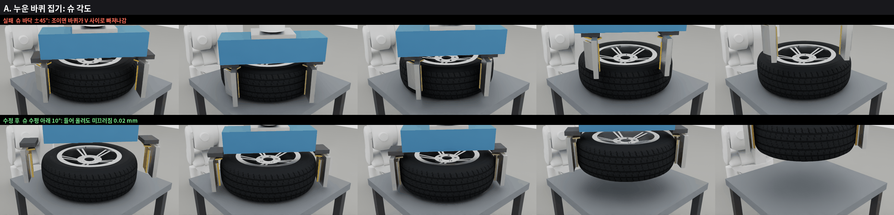 |
| B 세우기 | 수평 아래 20°: 세우는 중 바퀴 이탈(기울기 142°) | 10° | 허브 앞 도착, 기울기 0.01° | 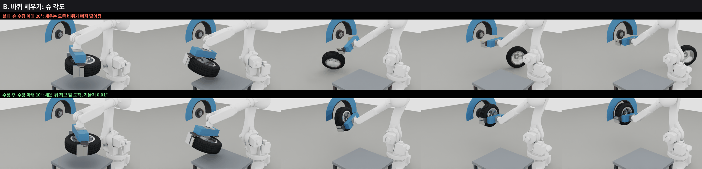 |
| C 두 조 동기화 | 독립 구동: 정렬 후 중심 21 mm 어긋남 | 미믹 관절(랙·피니언) | 정렬 0.06 → 0.03 mm | 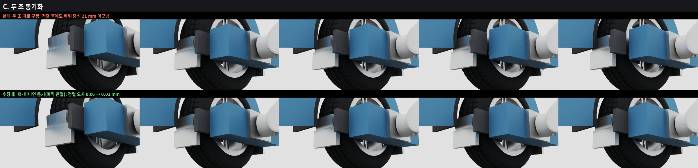 |
| D 이동 경로 | 관절 공간 한 번 이동: 바퀴 27° 비틀림, 슈 접촉력 9.2 kN | 허브 축 경유점 → 직선 진입 | 충돌 0 |  |
| E 비전 정렬 | 보정 없음: 구멍-스터드 0.35~0.48 mm, 삽입 중 접촉력 최대 519 N (틈 0.7 mm 안이라 장착은 됨) | 허브 앞 비전 보정 2회 | 0.03 mm, 0.009°, 위상 0.0°, 최대 146 N | 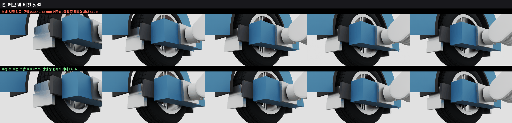 |
| F 삽입·놓기 | 위치 제어로 1 mm 더 밀고 놓음: 놓는 순간 바퀴가 튕겨 이탈(간격 21.7 mm, 18.8°) | F/T 힘 제어 145 N → 안착 판정 → 18 N으로 힘 빼고 놓기 | **장착 유지: 간격 1.4 mm, 기울기 1.1°** |  |
| G 전체 | — | — | 집기부터 장착까지 성공 | 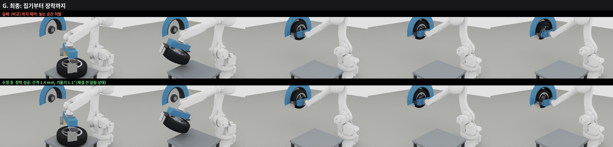 |

## TS-15 (11/27) 파일럿 안착·놓기 해결 (dbg45~48) → **장착 성공**

| 회차 | 현상 | 원인 (확인 방법) | 조치 | 결과 |
|---|---|---|---|---|
| dbg45 | 허브 접촉력 0인데 바퀴가 1~3 mm씩 튕김 | 큰 접촉 상대 집계: 전부 장착면 삼각형 ↔ **원통 기본 도형 파일럿** | 파일럿을 144각형 프리즘으로 (내접 33.462 mm, 틈 0.086 mm) | 안착 0.32 mm, 기울기 0.001°, 130 N |
| dbg46 | 놓을 때 바퀴 이탈 | 138 N으로 누른 채 조를 엶 → 타이어 링 압축이 풀리며 튕김 | 안착 판정(힘 ≥ 90 %, 0.3 s 이동 < 0.02 mm) 뒤 0.6 s 동안 18 N까지 힘 빼고 놓기 | — |
| dbg47 | 놓은 뒤 바퀴가 허브를 32 mm 관통 | 바퀴 무게가 파일럿으로 넘어가며 0.87° 기울 때 파일럿 오프셋 0.02 mm로 접촉이 늦게 잡혀 파고듦 | 파일럿 접촉 오프셋 0.2 mm (다각형이라 가짜 접촉 없음) | — |
| dbg48 | **장착 유지** | — | — | 간격 1.4 mm, 기울기 1.1°, 반경 1.0 mm (11/26 해제 시험 1.45°와 같은 수준) |

- 판정: `mounted` = 놓은 뒤 간격 < 2 mm(파일럿 12 mm 물림 유지), 기울기 < 2°, 반경 < 2 mm. 이후 체결로봇 너트가 당겨 밀착.
- 같은 모델로 재실행: 위치 제어(`position_insert`)는 놓는 순간 이탈, 비전 없음(`novision`)은 장착되지만 삽입 접촉력 최대 519 N(보정 시 146 N).

## 목표와 합격 기준 (11/27 정리)

공정 시간 목표(바퀴 1개 ≤ 25 s, 택트 60 s 기준)와 단계별 수치 범위·근거는 [`../GOALS.md`](../GOALS.md)에 있다.
현재: 모든 품질 지표 합격, **공정 시간 약 37 s로 미달** → 세부 제어 과제.

## TS-16 (11/27) 조립 셀(`scene/wheel_cell.usda` 라이브 물리)에 통합

자세한 내용: [`../CELL_INTEGRATION.md`](../CELL_INTEGRATION.md)

| 문제 | 원인 (확인 방법) | 조치 | 결과 |
|---|---|---|---|
| 셀 장면을 재생해도 장착로봇 물리가 없음 | `wheel_cell.usda`는 키프레임 시연만 있음(강체·관절·충돌체 0개, 전수 조사). 라이브 물리(`cell.py`)는 옛 레일 경로 `/World/Orders/CN7_001/LeftMount`를 찾아 고정식 배치에서는 로봇을 만들지 않음 | `wheel_mount_sim/cell_mount.py`의 `install()`을 `cell.py`에서 호출 (몇 줄), `CELL_MOUNT_SIM=0`이면 끔 | 좌우 장착로봇이 셀 `PARK`에 서서 8 s 동안 0.011 mm 유지, 접촉 0 (`cell_check.sh`) |
| 배치가 바뀌면 안 됨 | 셀 URDF(`world2base` 0°)와 로봇 USD(−90°)의 기준 방향 차이 | 로봇을 셀 방향 + 90°로 놓아 관절각 의미를 맞춤 | 키프레임 로봇과 `PARK` 플랜지 위치 동일 (0.12, ±2.1228, 2.1587) m |
| 셀 검사 앱에서 scipy 없음 | 검사용 Kit 파이썬에 scipy 미설치 | 셀이 이미 만든 CAD 장착면 삼각형을 그대로 쓰고 모따기·재질·오프셋만 덧입힘 | 해결 |
| 셀 삽입 시험대 2종 실패 | ① 시험대는 76 mm/s(0.32 mm/스텝)로 미는데 파일럿 오프셋 0.2 mm → 8.9 mm에서 걸림 ② 시험대가 `Web_` 이름의 충돌체만 셈 | 파일럿 오프셋 0.8 mm(2.5 × 스텝 이동량), 장착면 이름 `Web_…MS` | 두 시험대 통과, 단독 시뮬레이션도 `mounted` 유지(22.3 s) |
| 셀 전체 흐름 5종 `feed_failed` | 우리 설치를 꺼도 똑같이 실패 → 팀원 배치 변경(집기 위치·컨베이어 이동) 뒤의 기존 문제 | 손대지 않음 (팀원 영역) | — |

## TS-17 (11/27) 집기 방식 변경: 벨트 중간 집기 구역 → 벨트 끝 적재식

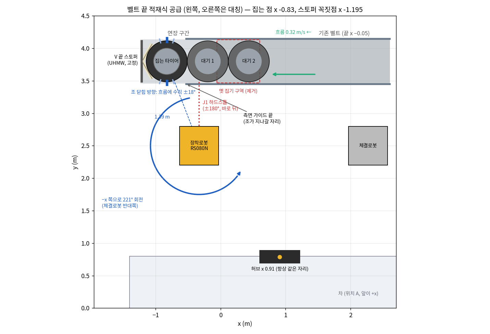

| 문제 | 원인 (확인 방법) | 조치 | 결과 |
|---|---|---|---|
| 셀 라이브 물리에서 타이어 4개 모두 `feed_failed` | 우리 설치를 꺼도 같음 → 팀 쪽 문제. 집기 구역과 바퀴 시작 위치가 차의 축 위치(x ±1.36) 기준으로 만들어져(`station.py`, `handling.py`) 고정식 배치·셀 이동 뒤 벨트(x −0.05부터)와 어긋난 것으로 추정 (원인은 팀 장면에서 따로 확인 필요) | 사용자 설계대로 집기 구역을 없애고 벨트를 −x로 연장, 끝에 고정 V 스토퍼, 타이어는 맞닿아 쌓임 (복제 맵 `cell_scene/`) | 앞 타이어 3.1 s 만에 `pick_ready`, 집는 자리 오차 ≤ 1.33 mm, 뒤 타이어는 맞닿아 대기 |
| 집은 뒤 −x 쪽으로 돌아야 하는데 J1 범위가 되는지 | J1 하드스톱 방향 계산 (`analysis/cell_reach.py`): 셀 베이스 방향에서 하드스톱이 로봇 바로 뒤 → +x 쪽 회전은 원래 불가, −x 쪽 221° 회전만 가능 | 베이스 방향은 그대로, 집는 자리를 베이스에서 −x 0.50 m에 둠 | J1 여유 18.8° (0.30 m면 10.4°로 팀 기준 15° 미달) |
| 측면 가이드(100 mm)가 조 자리를 막음 | 가이드와 트레드 사이 15.5 mm, 손가락이 들어갈 수 없음 | 가이드를 집는 타이어 앞(x −0.53)에서 끝냄, 끝 타이어는 V가 중심을 잡음 | 폭 방향 오차 ≤ 1.33 mm |

## TS-18 (11/27) 셀 안에서 장착 제어 (AMR 이송 제외, `cell_mount_run.py`)

차는 위치 A(앞 허브 x 0.91)에 고정하고, 좌우 장착로봇이 벨트 끝 맨 앞 타이어를 집어 앞 허브에 동시에 끼운다.

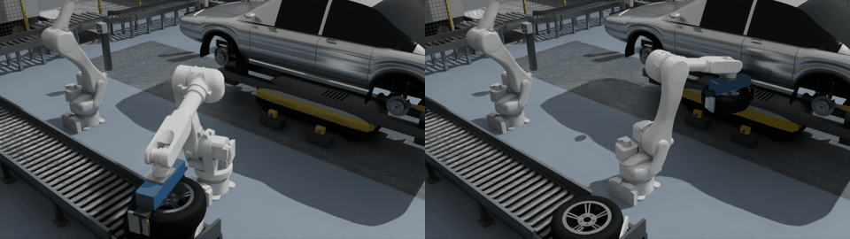

*실패 (dbg7): 집은 반경 그대로 −x 쪽으로 돌다가 차 옆면에 타이어가 걸림 (오른쪽 그림)*

| # | 문제 | 원인 (확인 방법) | 조치 | 결과 |
|---|---|---|---|---|
| 1 | 운반 중 바퀴를 놓침 (transfer_slip 1,297 mm) | 허브 쪽 IK가 어깨 너머 자세(J2 125°, J3 +85°)를 고름 → 관절 보간 경로에서 충돌, 조가 밀려 열림 (0.1 s 추적) | 집을 때와 같은 자세 계열(팔꿈치 위, \|J2\| < 60°)만 허용, J1을 20° 간격으로 바꿔 IK 시작점 줌 | 그 자세 사라짐 |
| 2 | 다시 놓침, t 19.7 s | 돌기와 세우기를 한 번에 하면서 J5가 0°를 지나며 바퀴가 부딪힘 | 운반을 ① J1만 회전 ② 세우기로 나눔 | — |
| 3 | J1이 17.6°에서 멈추고 바퀴가 빠짐 | 회전 도중 팔이 차 정면을 지나감. 베이스→차 옆면 1.59 m인데 바퀴 바깥 끝은 1.39 + 0.316 = 1.71 m (영상 확인) | 돌기 전에 바퀴를 반경 1.00 m로 당김 (바깥 끝 1.32 m, 여유 0.27 m), 돌아올 때도 같게 | 운반 미끄럼 1.1 mm |
| 4 | 오른쪽이 바퀴를 110 mm 빗겨 잡음 | Lula가 'ok'라고 낸 해 중 공구축 180° 뒤집힌 해가 섞임 (오프셋 = 조 라인 55 mm × 2) | IK 해마다 위치 < 1 mm, 자세 < 0.5° 검증 (24개 걸러짐) | 집기 오차 0.1 mm |
| 5 | 오른쪽이 허브 앞에서 구멍 위상 36° 어긋남 | 오른쪽 그립 좌표는 허브축 둘레로 180° 돌아 있어 왼쪽 공식(36 − 허브각)이 36° 틀림 | 오른쪽은 (0 − 허브각) mod 72 | 위상 오차 0.04° |
| 6 | 양쪽 모두 간격 9 mm에서 걸림 (140 N) | 접촉 기록: 보어가 파일럿에 170–290 N으로 걸림. 셀 CAD 보어가 72각형인데 꼭짓점이 원 위에 있어 현이 0.03 mm 안쪽 → 실효 반경 틈 0.09 → 0.06 mm | 보어 꼭짓점을 바깥으로 옮겨 현이 실제 보어(67.1 mm)에 오게 함. 걸림을 안착으로 오판하지 않도록 기대 이동량 확인 추가 | 양쪽 간격 0 mm로 안착 |
| 7 | (부수) 파일럿 접촉 오프셋 | 0.8 mm는 틈의 9배 | 0.35 mm (셀 시험대 76 mm/s의 스텝당 0.32 mm 바로 위) | 셀 시험대 2종 통과 |


*성공 (final1): 왼쪽 위 집으러 감, 오른쪽 위 앞 허브에 끼운 바퀴, 왼쪽 아래 양쪽 동시 삽입, 오른쪽 아래 다음 타이어 위로 복귀*

(영상: TS-19의 단축 프로필 GIF)

| 항목 (seed 42, 기본 속도) | 왼쪽 | 오른쪽 | 목표 (`GOALS.md`) |
|---|---|---|---|
| 집기 오차 / 운반 미끄럼 | 0.1 / 1.2 mm | 0.1 / 1.1 mm | — |
| 구멍-스터드 어긋남 (삽입 전) | ≤ 0.09 mm | ≤ 0.13 mm | ≤ 0.30 mm ✅ |
| 누른 상태 간격 / 힘 | 0.0 mm / 134 N | 0.0 mm / 133 N | ≤ 0.5 mm, 145 N ✅ |
| 놓은 뒤 간격 | **2.14 mm** | **2.01 mm** | ≤ 2.0 mm ❌ (근소 초과) |
| 놓은 뒤 기울기 | 1.54° | 1.45° | ≤ 1.6° ✅ |
| 한 바퀴 시간 | 65.2 s | 65.2 s | 기본 프로필, 단축 미적용 |
| 다음 타이어 | 끝 스토퍼로 들어와 `pick_ready` | 같음 | — |

남은 문제: 놓은 뒤 너트 없이 걸려 있는 바퀴가 2.0–2.1 mm 처진다 (단독 시뮬 1.4 mm, 팀 인계 문서 중앙값 1.97 mm). 한 바퀴 65 s는 −x쪽 221° 회전 때문이며 단축 프로필은 아직 셀에 맞추지 않았다.

## TS-19 (11/27) 셀 장착: 한 바퀴 65 s → 25 s, 걸림 복구, 놓은 뒤 처짐 분석

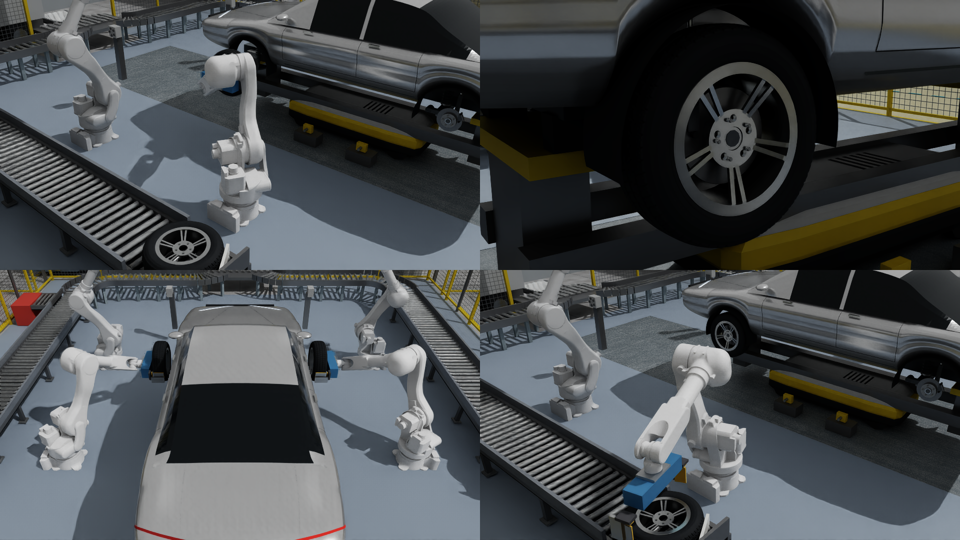

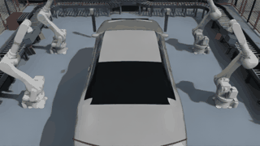 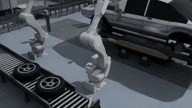 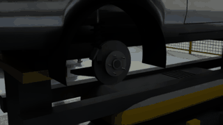

### 1) 한 바퀴 시간 (기본 65.2 s → 단축 25.1 s, 장면 길이 70 s → 30 s)

| 바꾼 것 | 근거 | 효과 |
|---|---|---|
| 타이어가 오는 동안 집는 점 위에서 대기 | 실제 정상 상태: 앞 사이클 끝에 그 자리로 돌아옴 | 첫 접근 5.5 s가 사이클에서 빠짐 |
| 들기 → 끌어당기기 → J1 회전(60 %) → 세우기(45 %) | 아래 2)의 미끄럼 측정으로 정함 | 회전·세우기 13.6 → 9.7 s |
| 빈 그리퍼 이동 80 %, 돌아가기 동작 2개를 1개로 | 빈 그리퍼가 차 앞을 지날 때 1.47 m (차 옆면 1.59 m) | 복귀 8.5 → 4.9 s |
| 빼기: 처음 40 mm만 0.1 m/s, 나머지 0.5 m/s | 슈가 트레드에서 떨어질 때까지만 느리게 | 3.2 → 2.1 s |
| 자유 접근 0.10 m/s, 힘 빼기 0.4 s, 대기 단축 | 400 N에서 멈춤 감시 유지 | 약 1.5 s |

단계별 (왼쪽, `final2`): 하강 1.5 · 잡기 1.3 · 들기 0.5 · 들어 올리기+당기기+회전 5.0 · 세우기+허브 앞 4.7 · 정렬 2회 1.8 · 삽입 2.9 · 힘 빼기 0.5 · 놓기+빼기 2.1 · 복귀 4.9 = **25.2 s** (목표 25 s, 0.2 s 초과)

### 2) 속도를 올리며 생긴 문제

| 문제 | 원인 (확인) | 조치 | 결과 |
|---|---|---|---|
| 운반 중 바퀴가 그립 안에서 16–18 mm 밀림 | 0.1 s 추적: 50 mm만 들고 '위로+안으로' 대각선 이동 → 끌어당기는 방향에 +x 성분이 있어 뒤 타이어(높이 205 mm)를 침, 조가 5 mm 벌어짐 | 250 mm 곧게 들어 올린 뒤 당김 | 미끄럼 1.0–1.3 mm |
| J1 회전 80 %에서 림이 그립 안에서 5° 흔들림 | 트레드만 잡으므로 림이 옆벽 스프링 위에서 흔들림 | 60 % (세우기는 45 %에서 1.2 mm) | 미끄럼 ≤ 1.3 mm |
| 정렬 1회로는 2/4회 9 mm에서 걸림 | 걸린 경우 파일럿 앞 반경 오차 0.064–0.074 mm, 성공 0.048 mm. 비전 잡음(축당 1σ 0.05 mm)이 반경 틈 0.09 mm와 같은 크기 | 단축 프로필도 정렬 2회 + **걸림 복구**(5 mm 뒤로, 다시 측정, 다시 누름, 최대 2회) | 걸린 경우 1회 재시도로 안착 (fastB2 오른쪽), 최종 실행은 양쪽 첫 시도에 안착 |
| 144조각 보어 고리 시도 | 얇은 2.5° 조각과 파일럿 사이 PhysX 접촉 충격 1e5 N, 놓은 바퀴가 허브 안으로 62 mm (fastB3) | 되돌림: CAD 72점 보어, 꼭짓점을 바깥으로 | 안정 |

### 3) 놓은 뒤 처짐 (간격 2.1–2.3 mm, 기울기 1.5–1.6°): 원인 분석

| 확인 | 결과 |
|---|---|
| 언제 생기나 | 조가 3 mm 열리는 0.1 s 안. 조 힘을 284 N까지 줄여도 그대로 붙어 있다가 접촉이 떨어지는 순간 기움 |
| 놓기 충격인가 | 아님: 조 압력을 0.6 s 동안 300 N까지 낮춘 뒤 열어도 2.13 mm / 1.53° 로 같음 (부드러운 놓기는 효과 없어 뺌) |
| 기우는 방향 | 바퀴 축 바깥 끝이 위로 (월드 z 성분 +0.028) |
| 물리 설명 | ET46: 무게중심이 장착면보다 46 mm 안쪽 → 놓으면 장착면 아래 끝을 축으로 위쪽이 바깥으로 기움. 보어-파일럿 틈(반경 0.09 mm)과 실제 물림 길이(약 7–9 mm, 양쪽 모따기 제외)가 막는 각도 ≈ 0.18/7–0.18/9 rad = 1.1–1.5° |
| 간격과의 관계 | 허브면 아래 끝이 닿은 채 기울므로 중심 간격 ≈ 75 mm × 기울기 → 1.5° ≈ 2.0 mm |
| 팀 결과와 비교 | `wheel_cell/HANDOVER.md` 완전 안착 후 놓음: 간격 중앙값 1.97 mm, 기울기 최대 1.56° — 같은 현상 |

즉 처짐은 시뮬 오류가 아니라 너트 없이 허브에 걸린 바퀴의 실제 거동이다. 목표표의 '놓은 뒤 간격 ≤ 2.0 mm'는 팀 측정 중앙값에서 가져온 값이라 기능 한계가 아니고, 기울기(≤ 1.56°, 5축 동시 체결 성립 범위)와 파일럿 물림 유지(간격 < 12 mm)가 실제 기준이다. 현재 왼쪽 1.61°는 그 한계를 0.05° 넘는다. 고치는 방법은 공정 설계 결정이라 사용자 확인이 필요하다 (아래 '남은 결정').

### 남은 결정

1. 목표 기준을 기능 기준으로 바꾸기: 간격 기준을 빼고 기울기 ≤ 1.56° + 파일럿 물림 유지로 판정 (현재 왼쪽 1.61°는 여전히 근소 초과)
2. 공정: 체결 헤드가 너트를 물리기 전에 휠을 허브면으로 밀어 세우는 동작 (실제 5축 너트러너 헤드의 일반적 방식) — 체결 쪽 작업
3. 공정: 장착로봇이 첫 너트가 물릴 때까지 잡고 있기 — 위치 A에서 체결이 없으므로 배치 변경 필요

결정 (11/27): 2번(체결 헤드가 밀어 세운 뒤 체결)으로 간다. 체결은 팀 작업이라 전달만 한다 → [`../HANDOVER_TO_FASTEN.md`](../HANDOVER_TO_FASTEN.md)

## TS-20 (11/27) 셀 시뮬을 창에서 실제 속도로 보기

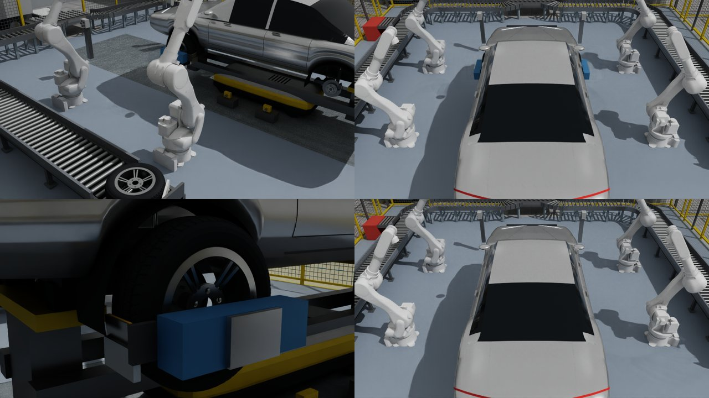

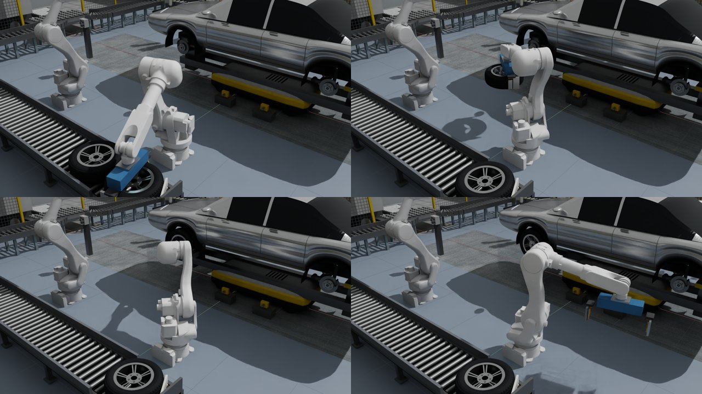

| 문제 | 원인 (확인 방법) | 조치 | 결과 |
|---|---|---|---|
| `--gui`에서 로봇이 아주 느림 (실제의 0.08배) | 4스텝마다 RTX 화면 갱신 | 16스텝마다(15 fps) | 약 4배 빨라짐 |
| 화면을 꺼도 0.27배 | 단계별 시간 측정: PhysX 계산은 스텝당 약 4 ms인데, 물리 결과를 매 스텝 USD에 다시 쓰면서 렌더러가 모든 물체 변경을 처리 (12 ms/스텝) | 물리 결과를 Fabric으로만 보냄 (`omni.physx.fabric`, 장면을 다 만든 뒤 켬: 먼저 켜면 충돌) | 0.68–0.76배 (화면 없이) |
| Fabric에서 바퀴·그리퍼가 시작 위치에 멈춰 보임 | 관절 로봇 링크만 Fabric으로 그려지고, 따로 된 강체(바퀴, Tool, JawR/L)의 화면 모델은 안 움직임 (speed7, rec1 영상) | 물리 없는 화면용 복사본을 만들어 매 프레임 PhysX 위치로 옮김 (바퀴 4, 그리퍼 6) | 허브의 바퀴·그리퍼가 제자리에 보임 (speed9) |
| 그래도 실제 속도(1.0배)는 못 냄 | 물리 계산만으로 실제의 약 0.9배 (바퀴 4개 × 트레드 충돌체 545개, 바퀴를 빼면 스텝당 2.9 → 1.2 ms) | 계산 실행마다 움직이는 물체 30개를 30 Hz로 `replay.npz`에 기록하고, `--replay`가 물리 없이 벽시계에 맞춰 재생 | **시뮬 30.2 s를 실제 30.2 s에 재생 (1.00배)**, 907 프레임 중 906 그림. 계산 기록과 위치 일치 확인 (27 s에 그리퍼 x −1.56, −x 쪽 복귀) |

- 놓은 뒤 기울기 결과는 실행마다 왼쪽·오른쪽이 번갈아 1.56°를 근소하게 넘음 (rec1: 오른쪽, speed9: 왼쪽). TS-19 결정대로 체결팀 전달 사항이다.
- 벨트 끝 적재식 공급(TS-17)은 복제 맵 대신 팀 장면 `scene/overrides/factory.usda`에 직접 넣음 (TS-21).

## TS-21 (11/27) 팀 커밋 받은 뒤: 벨트 끝을 팀 맵에 직접 넣기, 깨진 곳 2개, 받기 전·후 비교

### 1) 받기와 맵 반영

- 팀 커밋 11개를 받음 (1층 타이어 공급, AMR 정차·출고 경로, 체결 시험 등). 겹친 문서 1개(`CELL_INTEGRATION.md`)는 양쪽을 합침.
- 결정: 복제 맵(`cell_scene/`)을 없애고, 벨트 연장과 끝 스토퍼를 팀 장면 `scene/overrides/factory.usda`에 직접 넣음.
  이 파일은 팀이 손으로 고치는 공장 레이어이고, 장면을 다시 빌드해도 남는다. 맵팀 전달 문서는 필요 없어져서 뺐다.
- `tools/extend_belt_end.py`로 다시 쓰고, 두 번 돌려도 같은 파일이 나오는지 확인했다. 결과는 복제 맵 레이어와 같았다.


### 2) 받은 뒤 깨진 곳

| 문제 | 원인 (확인 방법) | 조치 | 결과 |
|---|---|---|---|
| 공급 검사 실패: 타이어 4개가 x −0.14~−0.19에서 멈춤 (`feed_failed`) | 새 팀 `conveyor.py`가 x ≤ PICK_X+0.33(0.60) 구간 롤러의 물리를 끔 (집기 구역이 자기 롤러를 가짐). 우리 연장 롤러와 그 구간 팀 롤러가 모두 물리 없이 남아, 타이어가 베드 위에서 미끄러지다 멈춤 (USD 경계 상자 조사, 코드 diff) | 끝 스토퍼가 있으면 이 제외 기준을 끔 (`cell_layout.pre_build`) | 앞 타이어 3.1 s에 `pick_ready` |
| 뒤 타이어가 '대기'가 아니라 '도착 중'으로 남음 | 새 팀 `station.py`가 타이어가 집기 구역 입구(axle+START_AHEAD)를 지나기 전에는 상태를 안 봄 | 끝 스토퍼에서는 시작 상태를 `queued`로 둠. 처음 시도한 axle=1e9는 팀 검사의 위치값(−1e12 mm)을 망가뜨렸고, START_AHEAD 바꾸기는 이송 거리 값을 망가뜨려서 둘 다 버림 | 공급 검사 PASS. 팀 검사에서도 위치값이 바르게 나옴 (앞 −0.18 / −0.97 mm, 뒤 +631 mm) |

### 3) 검사 결과 (받은 뒤)

| 검사 | 결과 |
|---|---|
| 우리 공급 검사 `cell_feed_check.py` | PASS: 앞 타이어 3.09~3.14 s, 오차 ≤ 1.33 mm. 뒤 타이어는 631 mm 뒤에 맞닿아 대기 |
| 장착로봇 대기 검사 `cell_check.sh` | PASS (그리퍼 흔들림 0.011 mm, 접촉 0) |
| 팀 기본 검사 `check_physics.sh --seed 42` | 우리 변경이 있든 없든 실패. 변경 없으면 뒤 타이어가 '도착 중'으로 남음. 변경 있으면 뒤 타이어가 '대기'로 나옴 (검사는 네 개 모두 '집기 준비'를 기대) |
| 장착 시뮬 시드 42 (`output/cell/postpull5`) | 왼쪽: 끝까지 넣음(0.0 mm, 152 N) → 놓을 때 **파일럿에서 빠짐 15.73 mm / 4.93°**. 오른쪽: 9 mm 걸림, 재시도 2번 뒤 안착 → 2.05 mm / 1.47°, 한 바퀴 30.44 s |

### 4) 받기 전·후 비교 (받기 전 코드 + 우리 변경을 임시 폴더에 꾸려 같은 시드로 실행)

| 시드 | 받기 전 | 받은 뒤 |
|---|---|---|
| 1 | 왼쪽 걸림 2번 → 바퀴 떨어짐, 오른쪽 멈춤 | 양쪽 멈춤 |
| 2 | 왼쪽 걸림 → 10.7 mm, 오른쪽 2.18 mm | 2.16 / 2.22 mm |
| 3 | 왼쪽 2.34 mm, 오른쪽 멈춤 | 왼쪽 2.31 mm, 오른쪽 멈춤 |
| 4 | 2.30 / 2.16 mm | 2.29 / 2.19 mm |

- 결론: 같은 실패 유형이 받기 전에도 나온다. **받아온 변경이나 벨트 변경 때문이 아니다.**
- **'멈춤'의 실제 원인은 집기 실패**:
  - 기록은 정렬 단계 IK 실패로 남았다.
  - 그런데 그립 시각이 7.4 s로 정상(5.9 s)보다 늦었다.
  - 허브에 왔을 때 그리퍼와 바퀴 사이가 2.8~3.6 m였다. 즉 바퀴를 벨트에 둔 채 빈손으로 왔다.
- **결과가 예민함**: 같은 시드 42가 실행 조건(물체 추가, 접촉 기록 켜기)에 따라 0.03 / 2.29 / 15.7 mm로 달랐다. 판정은 시드 여러 개로 한다.

### 결정과 다음

- 결과를 `docs/GOALS.md` 4절(셀 기준)에 정리. 첫 시도 성공률은 지금 기준으로 0/10이고, 놓은 뒤 기준을 '파일럿 물림 유지'로 바꾸면 6/10.
- 푸시 8eaf49b. 커밋 메시지에 팀 영향(공급 시험이 x 0.27을 기대함, 뒤 타이어 '대기', 키프레임 시연은 옛 흐름)을 적었다.
- 다음 과제: ① 집기 실패 원인, ② 놓은 뒤 빠짐, ③ 걸림 복구, ④ 팀 공정과 통합 (`GOALS.md` 3절).

## TS-22 (11/28) 장착 제어 분리, 집기 실패·걸림 복구 수정, 확대 카메라 영상

### 1) 장착 제어 분리 (`mount_control.py`)

- `cell_mount_run.py`(1단계)는 그대로 두고, 같은 제어를 `CellEnv`(셀·PhysX·기록)와 `MountSide`(로봇 1대)로 나눴다.
  사이클은 단계별로 쪼갰다(prepare → wait_tire → pick → transfer → align → insert → release → home → judge). 2단계 ROS 2 sequencer가 이 단계를 하나씩 부른다.
- 같은 시드 42로 1단계와 **이벤트 35개가 모두 같음**을 확인했다(`output/cell/base1128` vs `mc1`).
- **새로 알게 된 것**: Isaac Sim을 두 개 동시에 돌리면 결과가 다르다. 각 조건 안에서는 매번 같다.
  - 동시 실행: 어제 postpull1/5와 같음
  - 단독 실행: postpull3/4와 같음
  - 어제 "같은 시드인데 0.1 / 2.3 / 15.7 mm"로 달랐던 원인 중 하나다. 시험은 반드시 하나씩 돌린다.

### 2) 집기 실패 (3/10) → 원인과 수정

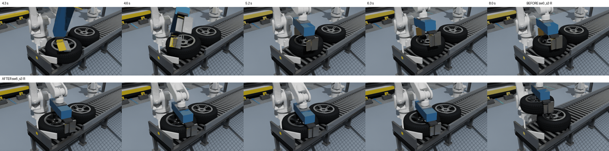

| | 내용 |
|---|---|
| 현상 | 그립 시각 7.4 s(정상 5.9 s), 바퀴를 벨트에 둔 채 허브로 가서 정렬 IK 실패 |
| 원인 (trace) | 집기 위 대기 자세가 **손목이 뒤집힌 해**(J4 ±180°, J5 +74°)로 잡히는 시드가 있다. 집기 자세(J5 −75°)로 가는 관절 이동에서 J4가 180° 돌면서 그리퍼가 타이어를 덮쳤다. 조가 25~55 mm 강제로 벌어지고(조 힘 수만 N), 하강 끝에서 목표와 225 mm 어긋났다. 성공한 실행은 J4 변화 0, J6만 13~34° |
| 수정 | 대기·접근 자세를 J5 < 0(집기 손목 자세)로 고르고, 접근은 관절 변화가 가장 작은 해를 쓴다(`MountSide.pick_key`). 들어 올린 뒤 바퀴가 30 mm 이상 따라 올라왔는지 확인해서, 아니면 `fail:pick`으로 바로 멈춘다 |
| 결과 | 집기 **22/22** (시드 1~10, 42). 접근 이동 J4 변화 0 |

영상: [수정 전](media/cell1128/pick_before.gif) · [수정 후](media/cell1128/pick_after.gif)

### 3) 9 mm 걸림 → 원인 분석과 복구 수정

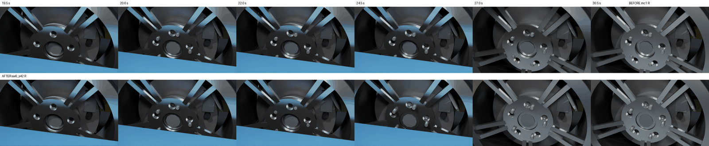

- **9 mm의 정체**: 보어 모따기 1.5 mm와 파일럿 끝 모따기 1.5 mm를 더한 3 mm 지점(간격 12 → 9 mm)이다. 두 모따기를 지나는 동안 중심이 맞지 않으면 원통면끼리 만나는 곳에서 걸린다.
- **중심이 안 맞는 이유**: 측면 순응 제어의 속도 한계가 0.5 mm/s다. 20 mm/s로 모따기 3 mm를 지나는 0.15 s 동안 측면으로는 최대 0.075 mm밖에 못 움직인다. 걸렸을 때 측면 보정량도 0.02~0.07 mm였다. 또한 림이 타이어 스프링에 매달려 있어서 모따기의 옆 힘을 F/T가 거의 못 느낀다(가설). 실제 셀이라면 RCC 같은 수동 순응 장치가 필요한 상황이다.
- **재시도가 실패한 이유**: 그리퍼를 5 mm 물려도 타이어가 슈 안에서 늘어나기만 하고, 바퀴는 8.5~11.8 mm에 남아 파일럿에서 빠지지 않았다. 그래서 다시 측정해도 같은 자리(8.546 mm)에서 다시 걸렸다.

| 시도 | 결과 | 결정 |
|---|---|---|
| 재시도 때 바퀴가 실제로 14 mm 이상 빠질 때까지 4 mm씩 물러남(최대 24 mm). 안 빠지면 `fail:jam` | 재시도 회복 **7/7** | 채택 |
| 파일럿 구간(남은 거리 14~6 mm) 삽입 속도 1/4 | 걸림 seed 3 오른쪽은 풀림, seed 1 왼쪽은 오히려 고착. 사이클 +1.2 s | 버림 |
| 같은 구간 측면 보정 0.5 → 5 mm/s, 불감대 10 → 3 N | 표 4)의 A/B로 판정 | 4) 참고 |
| 놓을 때 100 N으로 누르며 조 열기 | F/T 실제 힘 11~14 N(슈가 트레드에서 미끄러짐), 4/4 기욺 | 버림 |

영상: 확대 [수정 전](media/cell1128/insert_zoom_before.gif) · [수정 후](media/cell1128/insert_zoom_after.gif), 허브 [수정 전](media/cell1128/insert_hub_before.gif) · [수정 후](media/cell1128/insert_hub_after.gif)

### 4) 결과 (새 기준: 허브 면 69 mm, 체결 쪽 스터드 끝)

시드 1~10과 42, 로봇 2대 = 22회. 팀 최신 코드(8df096b)를 받은 뒤 하나씩 돌렸다(`output/cell/ns_s*`).

| 항목 | 11/27 (TS-21, 10회, 허브 면 79 mm) | **11/28 새 기준 (22회)** | 목표 (`GOALS.md`) |
|---|---|---|---|
| 집기 | 7/10 | **22/22** | 10/10 |
| 첫 삽입 걸림 (9 mm) | 2/7 | 6/22 | 0 |
| 걸림 재시도 회복 | 1/2 (나머지 빠짐) | **6/6** | — |
| 장착 판정 (`params.MOUNTED`: 간격 < 2.0 mm, 기울기 < 2.0°, 반경 < 2 mm) | 0/7 | **19/22** | ≥ 99.5 % |
| 놓은 뒤 간격 / 기울기 | 2.05–2.31 mm / 1.47–1.66° | 대부분 1.66–1.98 mm / 1.37–1.63°, 평평 2회(0.05–0.08 mm) | ≤ 2.0 mm / ≤ 1.6° |
| 경계 초과 | — | 2회 (2.05 mm/1.69°, 2.09 mm/1.72°) | |
| 놓을 때 바퀴가 허브 안으로 뚫고 날아감 | 0 | 1회 (시드 10 오른쪽) | 0 |
| 공정 시간 (걸림 없음 / 있음) | 25.04–25.11 s / 30.44 s | 25.02–25.57 s / 28.4–35.5 s | ≤ 25 s |

**A/B** (같은 새 기준, 시드 1·3·5·7·42 = 10회, `ab0_s*`): 파일럿 구간 측면 보정 끔 → 장착 8/10, 걸림 3회(1회 회복 실패). 켬 → 장착 9/10, 걸림 3회(모두 회복).
- 측면 보정 변경으로 **걸림 횟수는 줄지 않았다**.
- **놓은 뒤 간격이 2.0 mm 아래로 내려온 것은 허브 면 69 mm(확정값) 때문**이다. 79 mm일 때는 같은 제어로 2.0–2.5 mm였다(`sw4_*`).

**남은 문제**
1. 9 mm 걸림 27 %: 재시도가 막지만 한 번에 3–10 s를 쓴다. 수동 순응(RCC) 모델이나 림-타이어 결합 강성 확인이 필요하다.
2. 놓을 때 물리 뚫림 1/22 (TS-19 fastB3와 같은 유형): 연속 충돌 감지(CCD)나 솔버 반복 수를 시험해야 한다.
3. 공정 시간: 걸림이 없어도 25.0–25.6 s로 목표를 조금 넘는다.

### 5) 확대 카메라 (재생 전용)

- `mount_control.py --replay-video RUN_DIR`: 계산 실행이 남긴 `replay.npz`를 물리 없이 그려 GIF로 저장한다. 결과에 영향이 없다.
- 카메라는 재생할 때만 만든다(`zoom_left/right`, `pick_left/right`, `hub_right`). 확대 카메라는 허브 축선 바깥 위쪽에서 스포크 사이로 센터 보어, 볼트 구멍, 스터드를 본다. 조명은 재생할 때만 켠다. 조정은 `MOUNT_ZOOM="dx,dy,dz,초점"`으로 한다.
- 바퀴를 끼우면 허브 면과 패드 사이 틈은 림 바깥통에 가려서 어떤 시점에서도 보이지 않는다. 대신 스터드가 웹 앞으로 나온 길이로 안착 정도가 보인다.

### 6) 같은 시간대의 다른 변경

- 다른 세션이 12:54에 `cell_mount.py`의 허브 면 충돌체를 79 → 69 mm로 바꿨다(`assets/README.md` 확정값). 그 앞의 시험(sw0~sw5)은 79 mm, 뒤의 시험(sw6~)은 69 mm에서 돌았다. 그래서 4)는 새 기준에서 다시 돌린 결과만 쓴다.
- 스터드 규격 비교: [`../STUD_SPEC.md`](../STUD_SPEC.md). 체결 쪽 형상에 맞춰 스터드 끝을 2.0/1.5 mm에서 1.2/1.3 mm로 바꿨다(`params.STUD_TIP`, `MOUNT_STUD_TIP=cell`이면 예전 값).

### 7) 차량 전체: A 앞바퀴 → 차량 이동(가짜 AMR) → B 뒷바퀴, 차체 다이내믹

- **가정**: 차량 이송은 AMR팀 담당이다. 여기서는 AMR 받침과 리프트(잠긴 도크 클램프와 같음)를 6 s 동안 부드러운 속도 곡선으로 +2.720 m 옮기고, 차체는 리프트 받침 위에서 물리로 따라간다(`mount_control.py --car --car-dynamic`). 앞바퀴가 하나라도 장착되지 않았으면 차를 옮기지 않는다.
- **차체 변위**: 장착하는 동안 최대 0.033 mm, 요 0.0009°. 팀의 클램프 잠금 시험(허브 ≤ 0.1 mm)과 맞는다.

| 시드 | FL | FR | RL | RR |
|---|---|---|---|---|
| 1 (`carB1`) | 1.84 mm / 1.51° | 0.04 mm / 0.03° | 1.81 mm / 1.49° | 0.04 mm / 0.00° |
| 42 (`carR42`) | 0.08 mm / 0.06° | 1.70 mm / 1.40° (걸림 1회) | ❌ 집기 힘 없음 | 0.08 mm / 0.06° |

**두 번째 사이클 집기 문제 2개**

| 문제 | 원인 | 조치 | 결과 |
|---|---|---|---|
| 뒷바퀴를 쥐고 들자 23~24 mm만 따라오고 3° 기욺 | 고정 대기(t_close + 0.2 s = 1.29 s)가 첫 사이클(조가 타이어 근처에서 출발)에만 맞았다. 앞바퀴를 놓을 때 조를 55 mm 열어서, 두 번째 사이클은 닫는 데 0.75 s를 쓰고 닿은 뒤 0.54 s 만에 들었다 | 조가 멈출 때까지 기다린 뒤 1.2 s 쥠(최대 3 s) | 시드 1 RL·RR 성공 |
| 시드 42 RL: 조가 0.33~0.35 mm에서 힘 0~14 N으로 멈춤 (정상은 0.19~0.24 mm, 430~1,760 N) | 미확인. 잠자기(sleep)를 꺼도 같다. 이 타이어 위치에서 매번 재현된다 | 들기 전에 조임 힘 확인 → 200 N 미만이면 10 mm 열었다 다시 쥐기(2회) → 그래도 안 되면 들지 않고 `fail:pick` | 안전하게 멈춤(바퀴는 벨트에 반듯이 남음). 원인은 남은 과제 |

### 8) 2단계: ROS 2로 나누기 (`cell_mount_ros2.py`)

나눈 기준(11/27 결정): 실제 셀에서 로봇 제어기 안에 있는 것(관절 서보, 240 Hz F/T 힘 제어, 그리퍼)은 Isaac Sim 쪽에 두고, 순서 결정은 ROS 2 노드로 뺐다. 비전·경로 계획(IK)도 아직 Isaac Sim 쪽 `MountSide`에 있다. Lula IK가 Isaac 파이썬에만 있기 때문이고, 다음에 노드로 뺀다.

| 토픽 (`ros2_config.py`, 임시 이름) | 방향 | 형식 |
|---|---|---|
| `/Parking` | 가짜 AMR → 셀 | `success` (A에서 1번, B에서 1번) |
| `/mount_robot/<left\|right>/cmd` | 순서 노드 → 제어기 | `FL:pick` 같은 단계 명령 |
| `/mount_robot/<left\|right>/state` | 제어기 → 순서 노드 | `FL:pick:done` / `FL:pick:fail:pick` / `busy` |
| `/Mount` | 순서 노드 → 셀 밖 | `FL:success` / `FL:fail:<pick\|ik\|jam\|release\|timeout\|feed>` |

시험(`ros2_nodes/run_ros2_test.sh`, 시드 1, 차체 다이내믹, ROS_DOMAIN_ID 102):

```
/Parking  success  (A)
/Mount    FL:success
/Mount    FR:success
(가짜 AMR: 앞바퀴 둘 다 success → 6 s 이동 → /Parking success (B))
/Mount    RR:fail:pick      ← 두 번째 사이클 집기 힘 없음(7절), 들기 전에 감지
/Mount    RL:success
```

- Isaac Sim 5.1에 들어 있는 Jazzy rclpy(파이썬 3.11)를 `cell_mount_ros2.sh`가 불러온다. 순서 노드는 시스템 ROS 2 Jazzy(파이썬 3.12)에서 돈다.
- 같은 시드라도 ROS 왕복 지연(몇 스텝) 때문에 1단계 실행과 결과가 똑같지는 않다. 시드 1이 `carB1`에서는 RR 성공, ROS에서는 RR 실패였다.

### 결정과 다음

1. **두 번째 사이클 집기 힘 없음**(조 0.33–0.35 mm, 0–14 N): 4회 중 2회 재현. 원인을 찾는 것이 1순위다.
2. 9 mm 걸림 27 %: 수동 순응(RCC) 모델, 림-타이어 결합 확인.
3. 놓을 때 물리 뚫림 1/22: CCD, 솔버 반복.
4. 비전·IK를 ROS 2 노드로 빼기.
5. 노션 페이지 반영: 연결(토큰)이 아직 없어서 이 파일이 원본이다.

## TS-23 (11/28 오후) 비전 없는 고정 셀에서 정밀도 끌어올리기: 레이저 정렬, 웹 푸셔, 접촉·타이어 물리 바로잡기

### 0) 조건과 도구

- **고정 셀**(`MOUNT_FIXED=1`, `config/fixed.json`): 허브 공차 0, 허브 위상 고정(스터드 12시), 벨트 위 타이어 각도 36° 고정.
- **비전 없음**: 위치는 처음 한 번 티칭해서 씁니다(`teach/cell_fixed.json`). 판단은 센서로만 합니다.
  - 안착 판정: 관절 엔코더로 계산한 플랜지 위치
  - 들기 확인: 조 위치·힘
  - 끼임 물러남: 정해진 이동량
- **간이 셀** `bench_insert.py`: 허브 코너 + 로봇 + 그리퍼 + 바퀴만 넣은 셀을 한 장면에 N개 복제합니다. 셀마다 어긋남과 제어 설정을 다르게 줍니다. `--gui`로 계산하면서 볼 수 있고, `--trace`는 40 Hz 기록입니다.
  - 같은 조건이면 결과가 같습니다.
  - 4개를 한 장면에 넣어도 계산 속도는 4배 느려집니다. 16개는 더 느렸습니다.
  - 그래도 삽입 1회 시험이 셀 전체보다 3~5배 빠릅니다.

### 1) 9 mm 끼임 (원인 2개)

| 원인 | 확인 | 수정 |
|---|---|---|
| 접촉 전 F/T 영점 오차(측면 4~11 N)를 측면 순응 제어가 따라가 바퀴를 0.3 mm 끌어내림 | 삽입 시작부터만 켠 접촉 기록(fx_dins FR): 파일럿에 닿기 전에 반경 오차 0.02 → 0.3 mm, 이후 `Web_255MSCh \| PilotTip` 접촉 | 측면 순응은 축 방향 힘 > 30 N(접촉 중)일 때만 동작 |
| 파일럿 접촉 오프셋 0.35 mm(틈 0.08 mm의 4배)가 파일럿 둘레에 예비 접촉을 만들어 패드가 옆면에 1,100 N으로 붙음 | 간이 셀: 정렬 오차 0.003 mm인데도 8.8 mm에서 정지, `Pad_115 \| Pilot` 1,100 N | 넣을 때 0.1 mm(끼임 0/8), **안착 뒤 0.35 mm로 바꿈**(0.1 mm로 두면 걸린 바퀴가 떨리다 빠짐) |

시도했다가 효과가 없어 버린 것: 나선 탐색(0/10), RCC 수동 순응(그리퍼+바퀴 36 kg이 수평축에 걸려 무게 보상이 틀어짐), 파일럿 틈 0.15 mm(빠짐 5/8로 악화).

### 2) 비전 없이 정렬: 레이저 변위 센서

- 티칭값만 쓰면 운반 중 그리퍼 안에서 바퀴가 밀리는 양(실행마다 0.1~0.2 mm 차이) 때문에, 정렬 오차가 파일럿 틈(0.08 mm)보다 커집니다.
- 그리퍼에 레이저 변위 센서를 달아 바퀴의 상대 자세를 잽니다. 면 3점 + 비드시트 턱 2점, Keyence IL급, σ 5 µm / 0.005°로 모델링했습니다. 허브는 티칭값을 씁니다.
- 결과: 0.2~0.3 mm 어긋남이 **0.007~0.017 mm**가 됩니다(`laser_align`).

### 3) 놓은 뒤 빠짐 (원인 4개)

| 원인 | 확인 | 수정 |
|---|---|---|
| 조를 열기 전 누르는 힘을 20 N으로 줄이면 바퀴가 1~2 mm 밀려 나옴 | 20 N 2/4, 60 N 4/4, 100 N 4/4 | `RELEASE_FORCE` 100 N |
| 누를 때 타이어가 림보다 2.1 mm 눌려 저장된 에너지가, 조가 열리는 순간 바퀴를 0.1 s 만에 7~11 mm 튕겨 냄 | 40 Hz 추적(pc15_z4t E1) | **웹 푸셔**(아래) |
| 조가 끝까지 열리다 휠하우스에 걸리고(약 29.7 mm), 슈 립(걸침 26 mm)이 타이어 어깨를 걸어 끌어냄(-1.75 kN) | co1t E1 추적 | 조 22 mm에서 정지(공압 중간 정지), 립 걸침 26 → 12 mm |
| **PhysX 침투 복원 속도**(기본값이 큼)가 접촉 중인 바퀴를 튕겨 냄. 로봇이 떠난 뒤에도 혼자 빠짐 | 같은 8개 조건: 제한 없음 6/8 → 0.05 m/s 8/8(7개 0.32 mm/0.0°) | 바퀴·타이어 최대 침투 복원 속도 0.05 m/s. 0.01은 허브로 0.3 mm 파고들고, 0.2도 8/8이라 예민하지 않음 |

**웹 푸셔**
- 조 사이 축선에 공압 실린더를 두고, 반경 44 mm 우레탄 패드로 센터 보어(r 33.5)와 너트 시트(r ≥ 45.8) 사이 웹을 누릅니다.
- 행정 25 mm, 비례 레귤레이터로 **150 N으로 누른 채 조를 열고 → 0.5 s 동안 30 N으로 줄인 뒤** 12 mm 물러나며 뗍니다.
- 시험 결과:
  - 60 N 고정: 조가 열릴 때 5/16이 튕김
  - 150 N 고정: 패드가 떨어질 때 바퀴가 흔들림
  - 쥐는 힘을 0으로 줄인 뒤 열기(B안): 4/8로 더 나쁨

### 4) 타이어 측벽 강성·감쇠 바로잡기

| 항목 | 이전 | 수정 | 근거 |
|---|---|---|---|
| 반경 | 180 N/mm | 1,700 N/mm | 승용차 타이어 77.2 Hz 면내 모드, 벨트 7.25 kg (Sivaramakrishnan, VT 석사논문 Table 5.5) |
| 비틀림 | 139 N·m/° | 1,364 N·m/° | 같은 논문, 59.0 Hz |
| 축 방향 | 65 N/mm | 700 N/mm | 자동차 타이어 면외 강체 링 모드 51~85 Hz → 0.45~2 MN/m의 아래쪽 (직접 실측값 없음) |
| 감쇠비 | 0.08 | 0.055 | 같은 VT 논문 모드 감쇠 0.050~0.056 |

- 이전 값은 타이어를 **바닥에 눌렀을 때의 수직 강성**(접지면 변형 포함)이었습니다. 림과 트레드 링 사이의 측벽 값이 아니어서 10~30배 부드러웠습니다.
- 수정 뒤 누를 때 타이어-림 어긋남이 2.1 → 0.2 mm가 되고, 8/8이 장착됐습니다.

### 5) 그리퍼 형상 수정

베이스 조가 타이어 접점(±311 mm)에 있어 몸체(±270 mm) 밖에 떠 보였습니다. PHL-W처럼 베이스 조를 몸체 가이드 위(±160~215 mm)로 옮기고, 핑거로 잇는 연결 암을 추가했습니다(사용자 화면 확인 지적). 간이 셀 4/4 장착.

### 6) 셀 전체 5회 연속 (차체 다이내믹, A 앞바퀴 → 이동 → B 뒷바퀴)

고정 셀, 비전 없이 티칭 + 레이저 정렬, 오늘 설정 모두 적용 (`output/cell/final5_s1`, `final5_s2`).

| 회 | FL | FR | RL | RR | 끼임 | 장착 중 차체 변위 |
|---|---|---|---|---|---|---|
| 1 | 1.54 mm / 1.26° | 0.00 / 0.00° | 0.00 / 0.00° | 1.64 / 1.35° | 0 | ≤ 0.036 mm |
| 2 | 1.53 / 1.26° | 0.00 / 0.00° | 0.00 / 0.00° | 1.65 / 1.36° | 0 | ≤ 0.015 mm |

- **바퀴 8/8 장착, 끼임 0, 놓은 뒤 모두 목표(2.0 mm / 1.6°) 안.** 1.5~1.6 mm / 1.3°는 ET46 무게중심 때문에 걸린 바퀴가 처지는 정상 상태이고, 나머지는 반듯이 앉음.
- **공정 시간 28.0~32.1 s/바퀴로 목표 25 s를 넘음.** 레이저 측정 2회, 푸셔, 힘 감소 단계, 엔코더 기반 안착 판정이 늘어난 몫이라 다음 과제.
- 오늘 아침 셀 시험(비전, 79 mm 허브 면)과 비교: 장착 3/10 → 19/22(낮) → **8/8(저녁)**.

### 결정과 다음

- 다음: **실패 처리(인식 + 재시도)**. 그 뒤 사이클 시간 단축, ROS 2 분리(팀 합의 후), 비전, 머신러닝 순서.
- 남은 확인: 웹 푸셔·레이저 센서의 실제 부품 선정, RCC 없이 정밀 끼움이 되는 이유를 실제 공차(파일럿·보어 실측)로 재확인.
